# SHAREBITE — Hyper-Local Food Rescue & Redistribution Ecosystem 🍲🤝🌱

> **Connecting Food Donors, Volunteer Riders, Verified NGOs, and Communities across India to eradicate hunger and eliminate food waste.**

[](https://vitejs.dev/)
[](https://react.dev/)
[](https://www.typescriptlang.org/)
[](https://supabase.com/)
[](https://leafletjs.com/)
[](LICENSE)

---

## 📌 Table of Contents

1. [🌟 Overview & Mission](#-overview--mission)
2. [⚙️ How It Works — The Complete Process (Poora Process)](#-how-it-works--the-complete-process)
3. [👥 Multi-Role Ecosystem & User Journeys](#-multi-role-ecosystem--user-journeys)
4. [📸 Website Visual Showcase & Screenshots](#-website-visual-showcase--screenshots)
5. [📂 Complete Codebase & Folder Structure](#-complete-codebase--folder-structure)
6. [🛠️ Tech Stack & Architecture](#-tech-stack--architecture)
7. [🔐 Security, Verification & RLS Policies](#-security-verification--rls-policies)
8. [🚀 Getting Started & Local Development](#-getting-started--local-development)
9. [🧪 Instant Demo Mode](#-instant-demo-mode)
10. [🤝 Contributing & License](#-contributing--license)

---

## 🌟 Overview & Mission

In India, an estimated **68 million tonnes of food is wasted annually**, while millions of undernourished children, elderly citizens, and families in low-income clusters struggle for their next meal. Commercial kitchens, banquet halls, restaurants, college hostels, corporate cafeterias, and event organizers regularly produce surplus food that is perfectly fresh, hygienic, and safe—yet ends up in urban landfills generating potent greenhouse gases (methane).

### 🎯 What ShareBite Solves:
**ShareBite** is a modern, real-time, hyper-local digital logistics and community network engineered to eliminate food waste by creating a zero-friction bridge between **Food Donors**, **NGOs/Shelters**, and **Volunteer Delivery Fleets**.

- **Zero Food Waste:** Food is listed with strict shelf-life countdown timers (2–4 hours) and claimed before it perishes.
- **Immediate Grassroots Distribution:** Direct connection with local orphanages, slum feeding camps, and homeless shelters.
- **Two-Factor Safe Handover:** Cryptographic OTP validation at both pickup and delivery prevents food leakage or diversion.
- **Measurable Environmental Impact:** Calculates cumulative meals served, kilograms of food diverted from landfills, and CO₂ emissions averted.
- **United Nations SDGs:** Directly advances **SDG 2 (Zero Hunger)**, **SDG 12 (Responsible Consumption & Production)**, and **SDG 13 (Climate Action)**.

---

## ⚙️ How It Works — The Complete Process

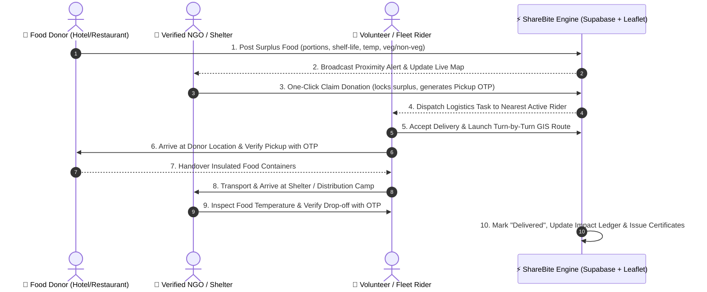

### The 5-Stage Lifecycle Explained (Kese Work Karega Poora Process):

#### 1. Surplus Food Listing (Food Donor)
A restaurant, wedding banquet, or hostel logs into their dedicated dashboard and clicks **"List Surplus Food"**.
- Specifies food name (e.g. *Dal Makhani, Jeera Rice & Phulkas*).
- Enters portion quantity (e.g. *120 Meals*) and food type (*Vegetarian, Jain, Non-Veg*).
- Sets storage condition (*Hot, Refrigerator, Room Temp*) and preparation timestamp.
- Selects expiry window / shelf-life countdown (e.g. *3 hours remaining*).
- Geo-coordinates are automatically extracted or pinned on the map.

#### 2. Real-Time Proximity Broadcast & Claim (NGOs / Shelters)
The moment a listing is created:
- Supabase Realtime notifies registered and verified NGOs within a 15 km radius.
- The surplus marker lights up on the **Interactive GIS Food Map** with color-coded urgency (Green: >3 hrs left, Orange: <2 hrs, Red: <45 mins).
- An authorized NGO accepts the donation with a single click, instantly preventing duplicate claims.

#### 3. Intelligent Rider Logistics Dispatch
- If the NGO does not have self-transport, ShareBite dispatches a pickup task to active **Volunteer Riders & Fleet Couriers** in the vicinity.
- The rider views pickup address, drop-off shelter, estimated driving time, meal portions, and contact options.

#### 4. Two-Factor OTP Handoff Verification
To guarantee complete accountability and safety:
1. **Pickup Phase:** When the rider arrives at the donor's premises, the donor asks for the **Pickup OTP** displayed on the rider's screen. Once entered, the status changes to *In Transit*.
2. **Delivery Phase:** Upon arrival at the shelter, the NGO coordinator enters the **Delivery OTP** to confirm receipt, packaging integrity, and temperature.

#### 5. Impact Quantification & Community Distribution
- Meals are served to beneficiaries at the community center or feeding drive.
- ShareBite automatically recalculates:
  - 🍽️ Total Meals Distributed
  - ⚖️ Kilograms of Food Rescued
  - 🌍 Kilograms of CO₂ Emissions Prevented
- The donor receives an official **Green Impact Certificate** and social badges.

---

## 👥 Multi-Role Ecosystem & User Journeys

ShareBite features purpose-built user interfaces and security route guards for 4 primary roles:

| Role | Key Capabilities | Primary Dashboard Route |
| :--- | :--- | :--- |
| **🍲 Food Donor** | List surplus food, shelf-life timer, view pickup status, live chat with shelter, download impact reports | `/donor-dashboard` |
| **🏢 NGO / Shelter** | Browse available food, real-time claim locks, manage community feeding drives, directory profile | `/ngo-dashboard` |
| **🛵 Volunteer Rider** | Accept delivery dispatch, interactive routing, pickup/drop-off OTP verification, earnings/badges | `/rider-dashboard` |
| **👥 Community Member** | Find nearby community food drives, request hunger assistance, view food distribution events | `/community-dashboard` |
| **🛡️ System Admin** | NGO Darpan ID verification, food quality audits, platform analytics, user moderation | `/admin` |

---

## 📸 Website Visual Showcase & Screenshots

All 13 user interfaces below were captured directly from the live ShareBite application:

### 1. Landing Page & Hero Section
*High-converting landing page showcasing the mission, real-time live counter, Indian city coverage, and dual calls-to-action.*
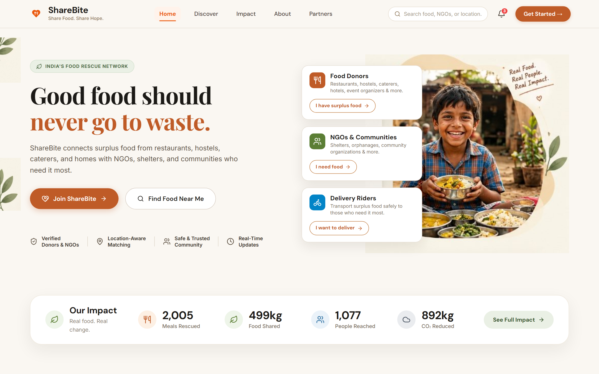

---

### 2. Multi-Role Onboarding Portal
*Authentic role-selection portal featuring Indian photography, tailored value propositions, and role-based themes.*
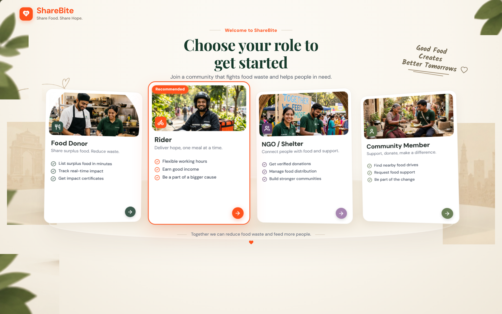

---

### 3. Food Donor Registration & Onboarding
*Split-screen authentication experience featuring culinary storytelling, quick demo login triggers, and input validation.*
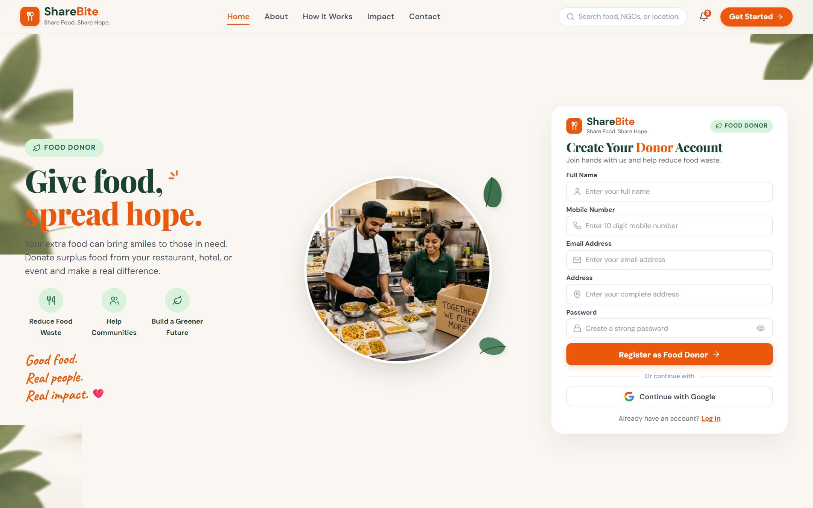

---

### 4. Delivery Rider & Volunteer Registration
*Dedicated registration portal for logistics heroes with vehicle selection (Bicycle, Motorcycle, EV, Van).*
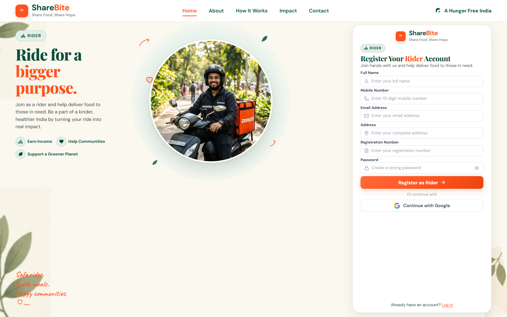

---

### 5. Verified NGO & Shelter Registration
*NGO partner portal collecting NGO Darpan ID, 80G tax registration, feeding capacity, and regional jurisdiction.*
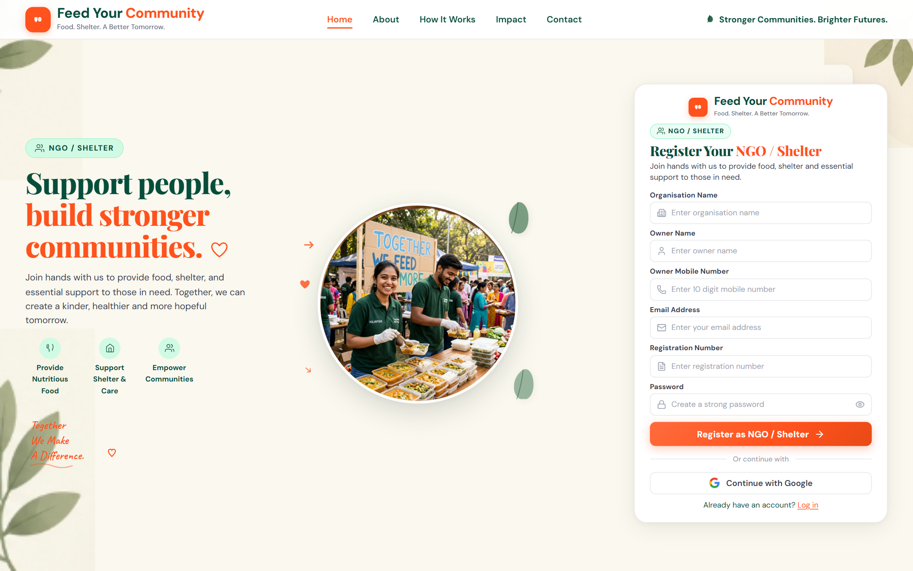

---

### 6. Food Donor Real-Time Dashboard
*Donor hub with live active donations, pending pickup statuses, meals donated counter, and quick action bar.*
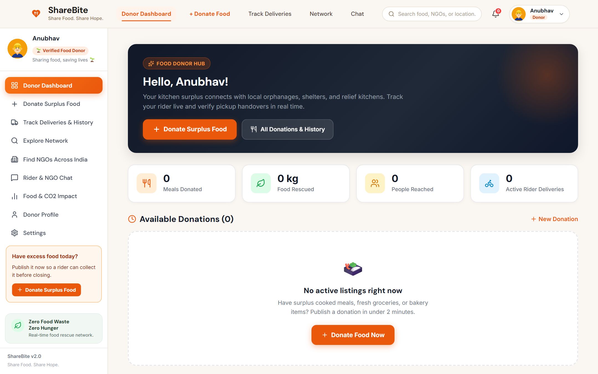

---

### 7. Surplus Food Donation Creation Form
*Intuitive listing wizard with food classification, shelf-life countdown slider, dietary tags, and pickup directions.*
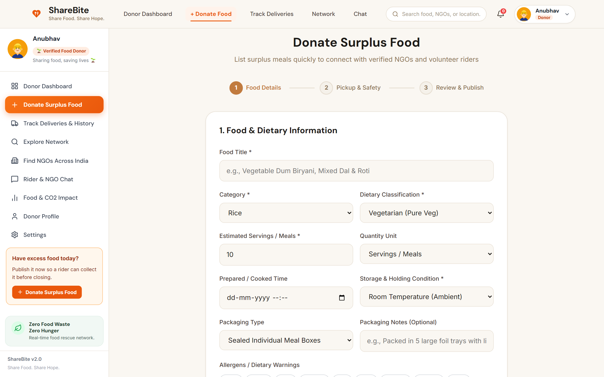

---

### 8. NGO Claims & Food Rescue Feed
*Real-time claim management interface showing incoming food parcels, status progression, and coordinator contact details.*
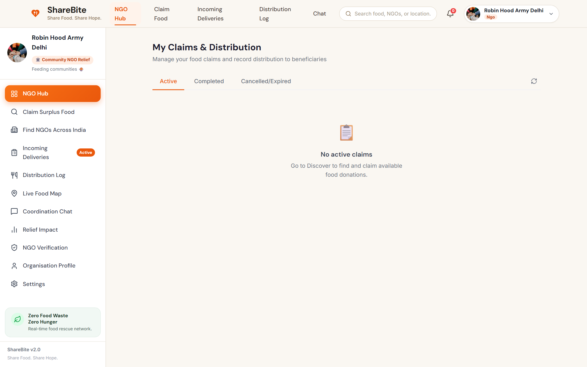

---

### 9. Delivery Rider Logistics Dispatch
*Active delivery console featuring pickup coordinates, recipient shelter details, route map, and OTP handoff validation.*
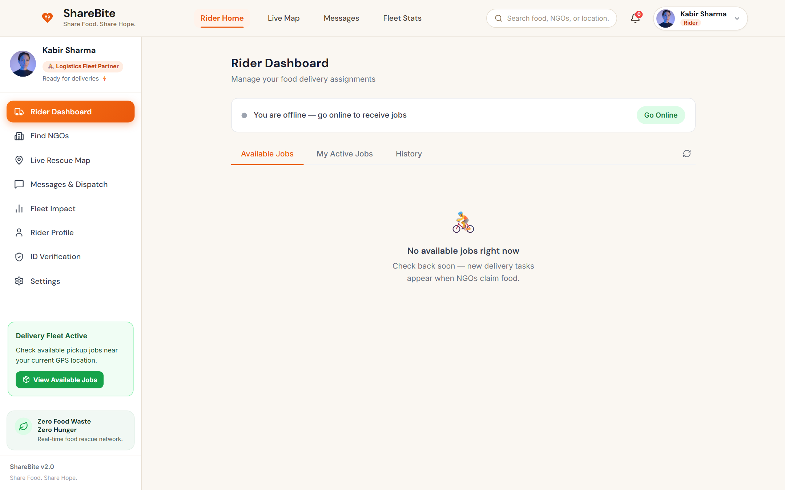

---

### 10. Interactive Leaflet GIS Food Rescue Map
*High-performance geospatial mapping engine showing real-time surplus clusters, hunger hotspots, and shelter locations.*
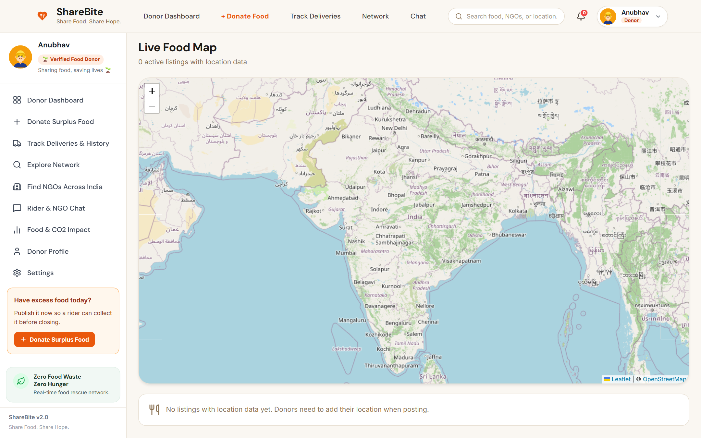

---

### 11. Verified NGO Directory & Discovery
*Searchable registry of verified Indian food relief organizations with Darpan validation badges and direct outreach channels.*
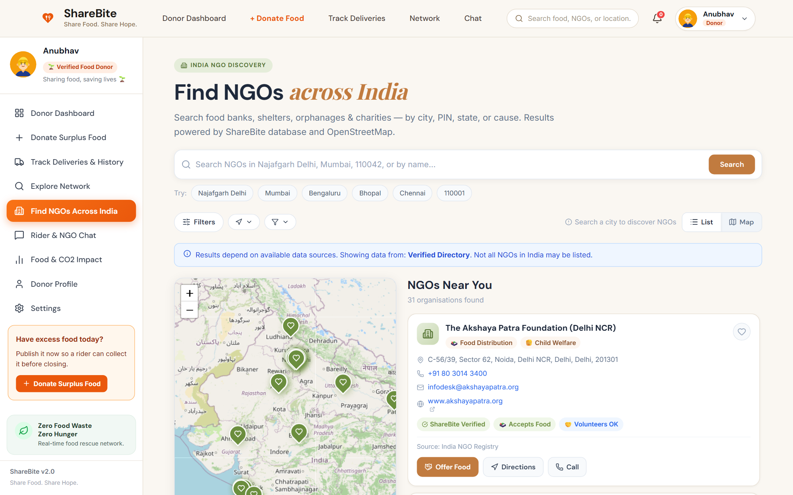

---

### 12. Environmental Impact & Carbon Analytics Dashboard
*Visual analytics calculating avoided carbon footprint, landfill diversion metrics, and community feeding milestones.*
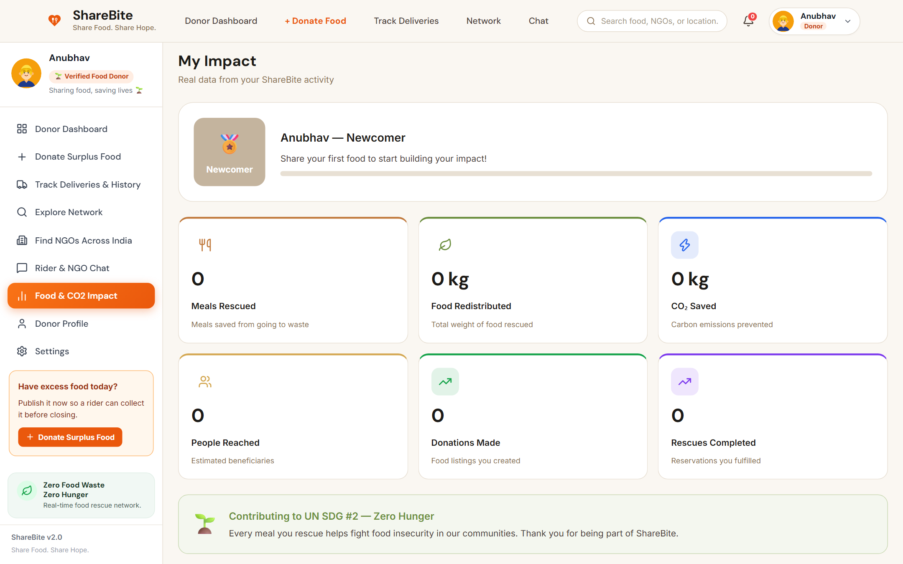

---

### 13. Real-Time In-App Chat & Multi-Party Coordination
*Secure communication suite connecting Donors, NGOs, and Dispatchers with real-time Supabase messaging.*
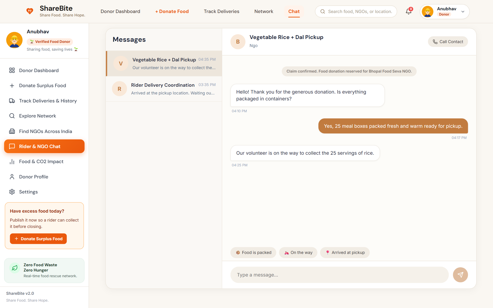

---

## 📂 Complete Codebase & Folder Structure

```
WEBSITE SHAREBITE/
├── docs/                                  # Documentation & high-res screenshots
│   └── screenshots/                       # 13 pristine application view captures
│       ├── 01-landing-hero.png
│       ├── 02-role-selection.png
│       ├── 03-donor-register.png
│       ├── 04-rider-register.png
│       ├── 05-ngo-register.png
│       ├── 06-donor-dashboard.png
│       ├── 07-create-donation.png
│       ├── 08-ngo-claims.png
│       ├── 09-rider-dashboard.png
│       ├── 10-interactive-map.png
│       ├── 11-ngo-discovery.png
│       ├── 12-impact-dashboard.png
│       └── 13-chat-coordination.png
│
├── public/                                # Static web assets, robots.txt, sitemap
│   ├── favicon.svg                        # ShareBite brand icon
│   ├── robots.txt                         # SEO crawler rules
│   └── sitemap.xml                        # Search index configuration
│
├── scripts/                               # Automation & tool scripts
│   └── capture_screenshots.js             # Headless Chrome screenshot engine
│
├── src/                                   # Application source code
│   ├── assets/                            # Indian culture photography & atmosphere assets
│   │   ├── donor_chef_photo.jpg           # Chef photography for donor experience
│   │   ├── rider_delivery_photo.jpg       # Rider photography for logistics
│   │   ├── ngo_volunteers_photo.jpg       # NGO relief volunteer photography
│   │   ├── community_member_photo.jpg     # Community member photography
│   │   ├── watermark_india_gate_clean.png # Cultural motif watermarks
│   │   └── watermark_skyline_clean.png
│   │
│   ├── components/                        # Reusable modular UI components
│   │   ├── auth/                          # Authentication components (RoleCard, etc.)
│   │   ├── food/                          # Food card, status badges, countdown timer
│   │   ├── layout/                        # Layout containers
│   │   │   ├── AppHeader.tsx              # Top navigation bar with user profile & badges
│   │   │   ├── AppShell.tsx               # Main authenticated layout container
│   │   │   ├── RoleBasedDashboard.tsx     # Dynamic role router
│   │   │   └── RoleRouteGuard.tsx         # Strict RBAC client-side guard
│   │   ├── map/                           # Leaflet GIS interactive map wrapper & markers
│   │   ├── states/                        # Empty, Loading, and Error state components
│   │   └── ui/                            # Buttons, inputs, modals, and tabs
│   │
│   ├── context/                           # React global state contexts
│   │   └── AuthContext.tsx                # Session management, Supabase Auth + Demo mode
│   │
│   ├── hooks/                             # Custom React hooks
│   │   ├── useDebounce.ts                 # Search and filter debouncing
│   │   ├── useGeolocation.ts              # Browser location services
│   │   └── useRealtime.ts                 # Supabase realtime channel listeners
│   │
│   ├── lib/                               # Library configurations & utilities
│   │   ├── supabase.ts                    # Supabase JS client client initialization
│   │   └── uuid.ts                        # UUID v4 generator and validation helpers
│   │
│   ├── pages/                             # Route-level view controllers
│   │   ├── app/                           # Authenticated dashboard views
│   │   │   ├── AdminPage.tsx              # Platform oversight, moderation & audit logs
│   │   │   ├── BeneficiaryDashboardPage   # Community assistance requests
│   │   │   ├── ChatPage.tsx               # Real-time multi-party direct messenger
│   │   │   ├── CreateDonationPage.tsx     # Surplus food creation form
│   │   │   ├── DiscoverPage.tsx           # Food listings search & filter feed
│   │   │   ├── DonationDetailPage.tsx     # Detailed food item profile & audit log
│   │   │   ├── DonationsPage.tsx          # Master donations overview
│   │   │   ├── DonorDashboardPage.tsx     # Food donor management console
│   │   │   ├── DonorDonationsStatus.tsx   # Live delivery status tracker for donors
│   │   │   ├── ImpactDashboardPage.tsx    # Environmental CO2 & meal analytics
│   │   │   ├── MapPage.tsx                # Fullscreen Leaflet geospatial map
│   │   │   ├── NGOClaimsDashboard.tsx     # Shelter claim management & queue
│   │   │   ├── NGODiscoveryPage.tsx       # Verified NGO search directory
│   │   │   ├── NotificationsPage.tsx      # System alerts and push notifications
│   │   │   ├── ProfilePage.tsx            # User profile, badges & contact info
│   │   │   ├── RequestsPage.tsx           # Community food assistance feed
│   │   │   ├── RiderDashboardPage.tsx     # Rider delivery logistics console
│   │   │   ├── SettingsPage.tsx           # Notification preferences & privacy
│   │   │   └── VerificationPage.tsx       # NGO Darpan / identity upload page
│   │   │
│   │   ├── auth/                          # Onboarding and auth pages
│   │   │   ├── AcceptorRegisterPage.tsx   # NGO / Shelter registration
│   │   │   ├── DonorRegisterPage.tsx      # Food donor registration
│   │   │   ├── RiderRegisterPage.tsx      # Rider & volunteer registration
│   │   │   ├── RoleSelectPage.tsx         # Visual role picker (TC-01, TC-03)
│   │   │   ├── SingleRoleAuthPage.tsx     # Unified login & signup form
│   │   │   ├── ForgotPasswordPage.tsx     # Password recovery workflow
│   │   │   ├── ResetPasswordPage.tsx      # Password update confirmation
│   │   │   └── AuthCallbackPage.tsx       # OAuth redirection handler
│   │   │
│   │   └── public/                        # Public unauthenticated pages
│   │       ├── LandingPage.tsx            # Homepage hero, stats, CTA
│   │       ├── AboutPage.tsx              # Organization story & background
│   │       ├── HowItWorksPage.tsx         # Visual process explanation
│   │       ├── PublicImpactPage.tsx       # Public metric transparency
│   │       └── PartnersPage.tsx           # NGO and corporate partner network
│   │
│   ├── services/                          # API & Database service layer
│   │   ├── auth.ts                        # Session handling & Demo authentication
│   │   ├── chat.ts                        # Realtime conversation threads & messages
│   │   ├── claims.ts                      # Donation claim lifecycle & OTP codes
│   │   ├── donations.ts                   # Surplus food CRUD & query filters
│   │   ├── impact.ts                      # Carbon offset calculations & statistics
│   │   ├── location.ts                    # Geocoding & coordinate calculation
│   │   ├── ngo.ts                         # NGO profile and verification methods
│   │   ├── ngoDiscovery.ts                # Verified NGO queries with filters
│   │   ├── notifications.ts               # In-app push notification dispatcher
│   │   └── partners.ts                    # Corporate & NGO partnership handling
│   │
│   ├── styles/                            # Design tokens and global CSS
│   │   └── index.css                      # CSS variables, Indian Earth palette, typography
│   │
│   ├── types/                             # TypeScript type definitions
│   │   └── index.ts                       # User, FoodListing, Claim, RiderTask, etc.
│   │
│   ├── App.tsx                            # Root routing configuration & route guards
│   └── main.tsx                           # Application mount point
│
├── supabase/                              # PostgreSQL database migrations & schemas
│   ├── complete_schema.sql                # Complete consolidated database schema
│   ├── chat_and_realtime_migration.sql    # Real-time chat tables & publication rules
│   ├── god_mode_migration.sql             # Admin superuser capabilities
│   ├── migration.sql                      # Base table definitions & relations
│   ├── moderation_migration.sql           # Food quality & safety reporting
│   ├── ngo_discovery_migration.sql        # NGO directory & Darpan schema
│   ├── phase2_14_migration.sql            # Extended profile, logs & certificates
│   ├── profiles_rls_fix.sql               # Non-recursive RLS policy definitions
│   ├── rider_delivery_migration.sql       # Rider dispatch, location & OTP handoff
│   └── web_fixes_migration.sql            # Web compatibility fixes
│
├── index.html                             # HTML5 document template
├── package.json                           # Dependencies and build scripts
├── tsconfig.json                          # TypeScript compiler settings
├── vercel.json                            # Vercel deployment & SPA routing rewrite
└── vite.config.ts                         # Vite build bundler optimization
```

---

## 🛠️ Tech Stack & Architecture

### Frontend Layer
- **Framework:** [React 19](https://react.dev/) + [TypeScript](https://www.typescriptlang.org/)
- **Bundler & Tooling:** [Vite 8.3](https://vitejs.dev/)
- **State Management & Server Cache:** [TanStack React Query v5](https://tanstack.com/query)
- **Routing:** [React Router v7](https://reactrouter.com/)
- **Mapping & Geospatial:** [Leaflet 1.9](https://leafletjs.com/) + [React-Leaflet 5](https://react-leaflet.js.org/)
- **Styling Architecture:** Pure CSS Modules (`.module.css`) + CSS Custom Properties Design System
- **Icons:** [Lucide React](https://lucide.dev/)
- **Date Handling:** [date-fns v4](https://date-fns.org/)

### Backend & Database Layer
- **Database:** [PostgreSQL 15](https://www.postgresql.org/) managed via [Supabase](https://supabase.com/)
- **Real-Time Subscriptions:** Supabase WebSockets (Realtime publication channels for Chat, Claims & GPS)
- **Security:** PostgreSQL Row Level Security (RLS) with security definer helper functions
- **Storage:** Supabase Storage buckets for food imagery and NGO Darpan certificates

---

## 🔐 Security, Verification & RLS Policies

1. **Strict Row Level Security (RLS):**
   - Donors can only modify their own food listings.
   - NGOs can only claim available donations and view assigned delivery tasks.
   - Riders can only update tasks assigned to their user ID.
   - Chat conversations are strictly restricted to verified participants of a specific food claim.
   - Infinite recursion protection implemented via `security definer` functions in `supabase/profiles_rls_fix.sql`.

2. **Dual-PIN OTP Verification:**
   - Single-use, time-bound 4-digit codes generated cryptographically on claim creation.
   - Ensures food reaches verified beneficiaries with zero diversion.

3. **Food Safety Disclosures:**
   - Mandatory temperature declarations (Hot, Chilled, Ambient).
   - Preparation timestamp and real-time shelf-life countdown.
   - Comprehensive allergen and dietary labeling (*Pure Veg, Halal, Jain, Non-Veg*).

---

## 🚀 Getting Started & Local Development

### 1. Prerequisites
- [Node.js](https://nodejs.org/) (v18.0 or newer recommended; tested on v24)
- [npm](https://www.npmjs.com/) or [pnpm](https://pnpm.io/)
- [Git](https://git-scm.com/)

### 2. Clone the Repository
```bash
git clone https://github.com/anubhavt675-gif/SHAREBITE-.git
cd SHAREBITE-
```

### 3. Install Dependencies
```bash
npm install
```

### 4. Setup Environment Variables
Create a `.env` file in the root directory:
```env
VITE_SUPABASE_URL=https://your-supabase-project.supabase.co
VITE_SUPABASE_ANON_KEY=your-supabase-anon-key
```
*(Note: If no Supabase credentials are provided, ShareBite automatically runs in fully functional Demo Mode!)*

### 5. Start Development Server
```bash
npm run dev
```
Open your browser at `http://localhost:5173`.

### 6. Build for Production
```bash
npm run build
npm run preview
```

---

## 🧪 Instant Demo Mode

ShareBite includes an embedded **Demo Authentication System** so evaluators, developers, and partners can explore every role instantly without creating a database:

1. Navigate to `/register` or click **"Join the Mission"**.
2. Select any role:
   - **🍲 Food Donor:** View surplus listing interface, create mock donations, track statuses.
   - **🛵 Volunteer Rider:** View dispatch orders, test OTP validation, preview GIS routes.
   - **🏢 NGO / Shelter:** Test live donation claims, manage distributions, review directory.
   - **🛡️ Admin:** Access platform moderation, safety audits, and metrics.
3. Click the **"One-Click Demo Login"** button at the bottom of the auth card to immediately enter the designated dashboard with rich pre-populated Indian mock data!

---

## 🤝 Contributing & License

Contributions, issues, and feature requests are welcome! Feel free to check the [issues page](https://github.com/anubhavt675-gif/SHAREBITE-/issues).

Distributed under the **MIT License**. See `LICENSE` for more information.

---

<p align="center">
  <b>Made with ❤️ in India for a hunger-free and waste-free future.</b><br>
  <sub>ShareBite &copy; 2026. Every meal shared is a life touched.</sub>
</p>
