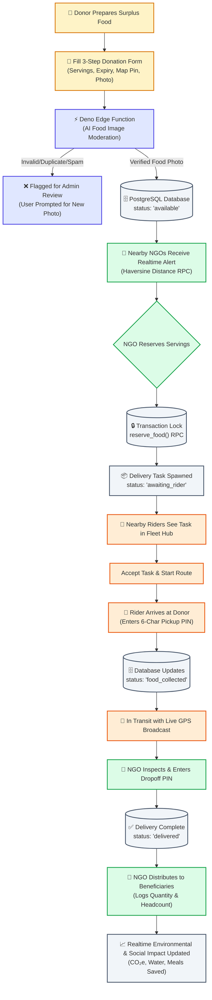
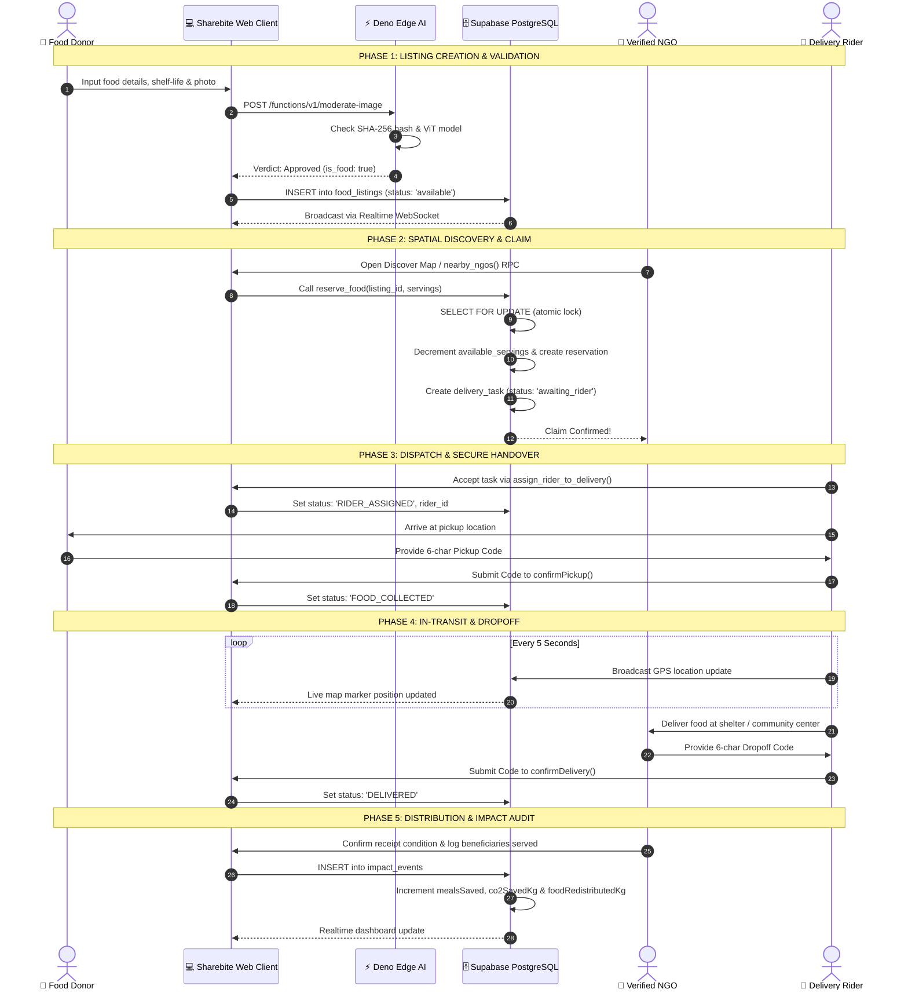
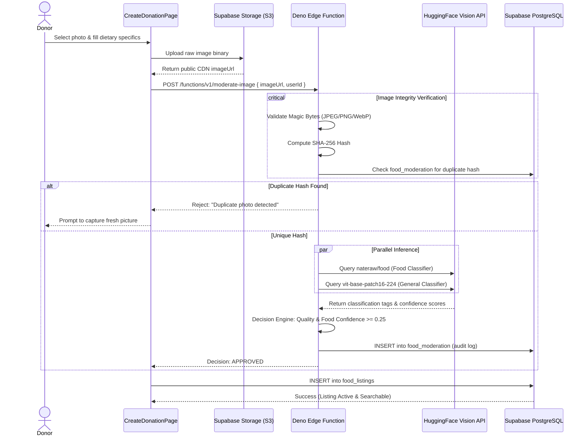
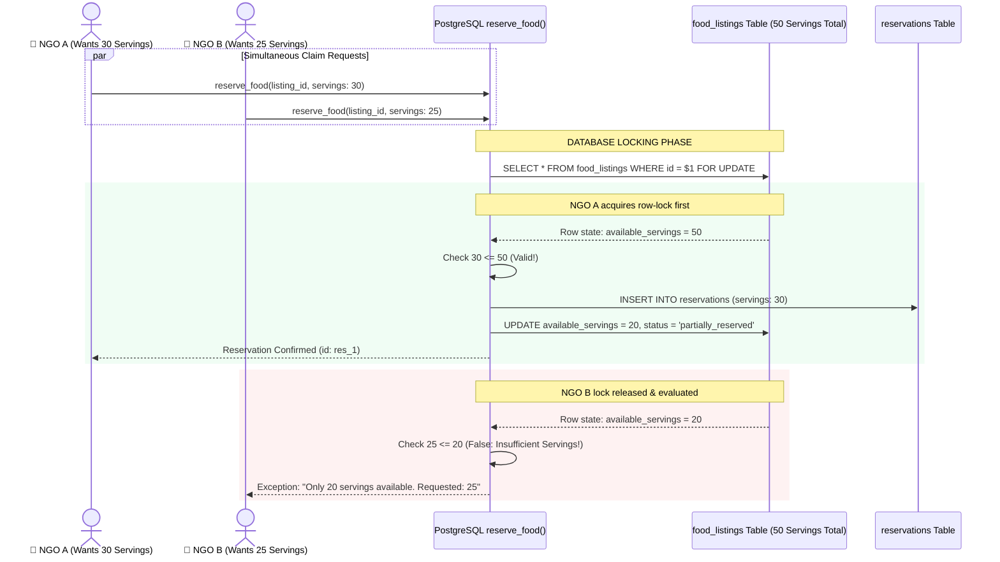
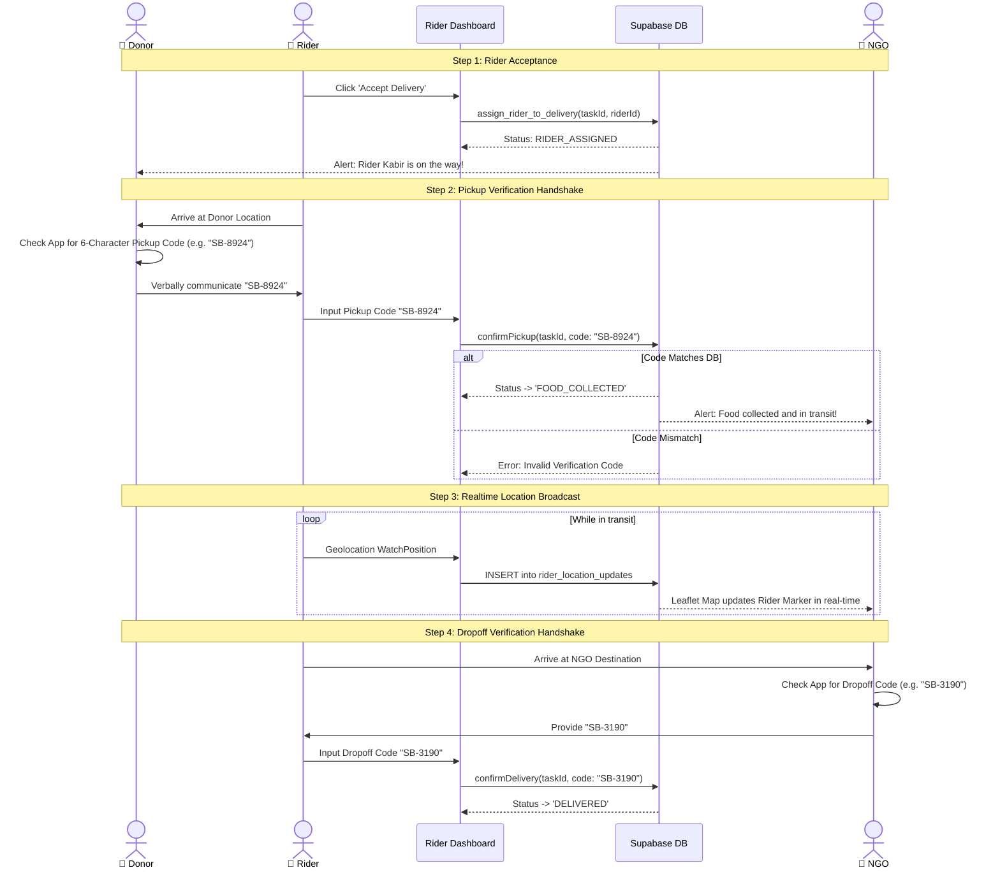
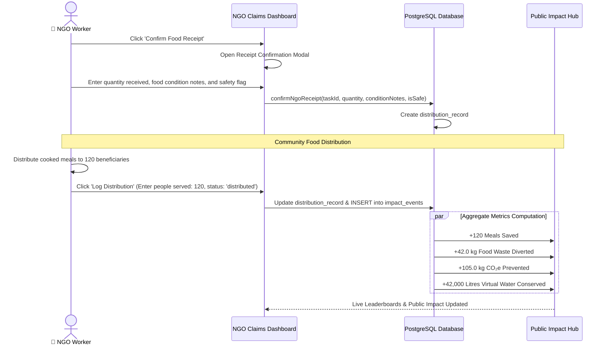
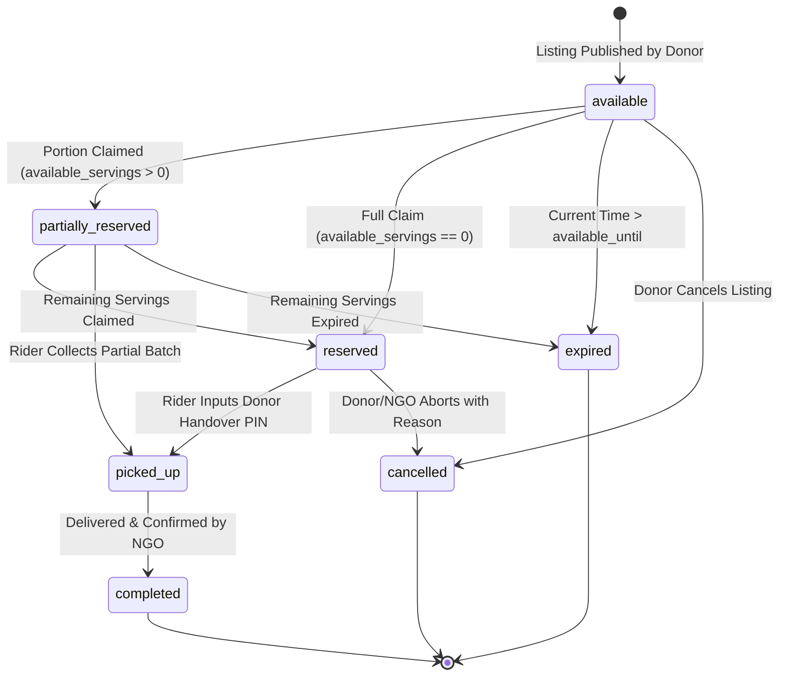
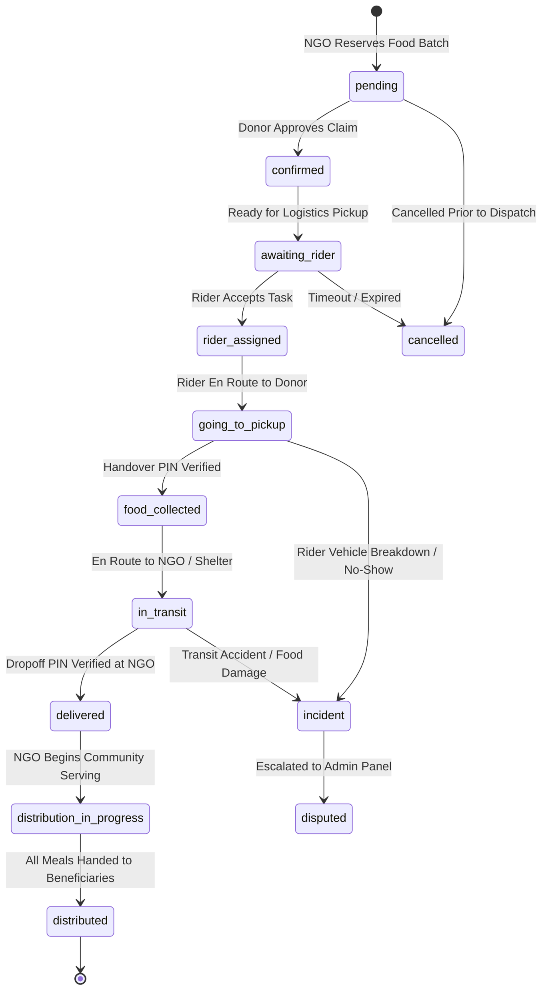
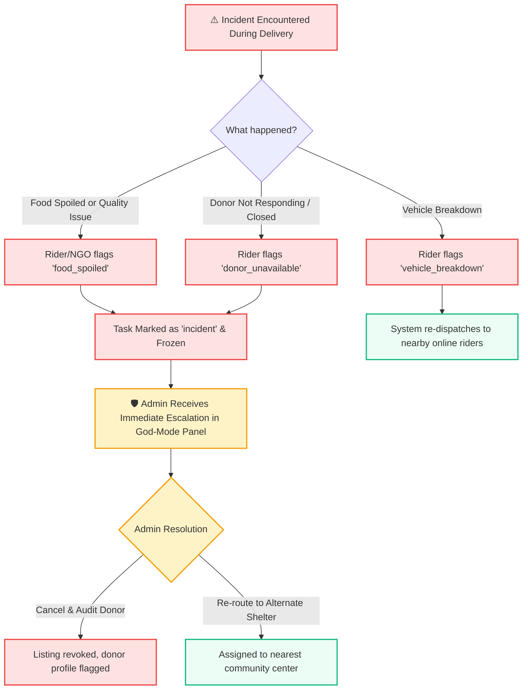

# 🔄 Sharebite — Complete Working Flow & Architecture Diagrams

> Comprehensive visual workflows, state machines, sequence diagrams, and lifecycle specifications for the Sharebite Food Rescuing Platform.

---

## 📋 Table of Contents

1. [High-Level End-to-End Ecosystem Flow](#-1-high-level-end-to-end-ecosystem-flow)
2. [Stakeholder Swimlane Workflow](#-2-stakeholder-swimlane-workflow)
3. [Sequence Diagram: Listing & AI Moderation](#-3-sequence-diagram-food-listing--ai-moderation)
4. [Sequence Diagram: Claiming & Concurrency Locking](#-4-sequence-diagram-ngo-claiming--concurrency-lock)
5. [Sequence Diagram: Dispatch, Live GPS & Handover PIN](#-5-sequence-diagram-dispatch-tracking--handover-pin)
6. [Sequence Diagram: Receipt & Community Distribution](#-6-sequence-diagram-receipt--community-distribution)
7. [Food Listing State Machine](#-7-food-listing-state-machine)
8. [NGO Claim & Delivery Lifecycle State Machine](#-8-ngo-claim--delivery-lifecycle-state-machine)
9. [Exception Handling & Incident Workflows](#-9-exception-handling--incident-workflows)

---

## 🌐 1. High-Level End-to-End Ecosystem Flow

---

## 🏊 2. Stakeholder Swimlane Workflow

---

## 🔍 3. Sequence Diagram: Food Listing & AI Moderation

Detailed workflow of how donor contributions are screened for safety, authenticity, and non-duplicate verification before becoming public:

---

## 🔒 4. Sequence Diagram: NGO Claiming & Concurrency Lock

How Sharebite prevents **race conditions** and double-claims when hundreds of NGOs search the same metropolitan area:

---

## 🚴 5. Sequence Diagram: Dispatch, Tracking & Handover PIN

Security handshake ensuring food is handed to the authorized rider and verified upon arrival:

---

## 🍲 6. Sequence Diagram: Receipt & Community Distribution

---

## 🏷️ 7. Food Listing State Machine

Lifecycle transitions of a food donation listing:

---

## 📦 8. NGO Claim & Delivery Lifecycle State Machine

---

## 🚨 9. Exception Handling & Incident Workflows

---

*Sharebite Flow Specifications — Version 1.0 | November 2026*
