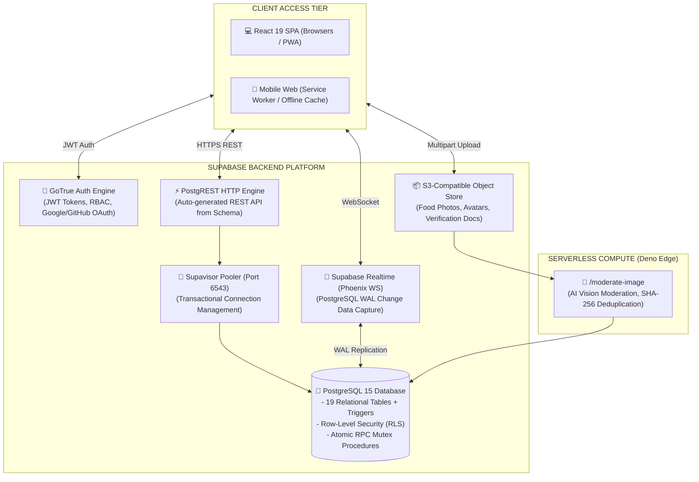

# 🗄️ Sharebite — Complete Backend Architecture & Database Specification

> **Deep-Dive Technical Specification of the Core Backend System**  
> PostgreSQL 15, PostgREST Auto-APIs, GoTrue JWT Identity, 19 Relational Schemas, Atomic Concurrency RPCs (`SELECT FOR UPDATE`), Row-Level Security (RLS), Supabase Realtime CDC, Supavisor Connection Pooling, and Deno Edge AI Vision Pipeline.

---

## 📋 Table of Contents

1. [Backend Architectural Overview](#-1-backend-architectural-overview)
2. [Supabase Cloud-Native Infrastructure](#-2-supabase-cloud-native-infrastructure)
3. [Relational Schema Specification (All 19 Tables)](#-3-relational-schema-specification-all-19-tables)
4. [Custom Enums & Domain Data Types](#-4-custom-enums--domain-data-types)
5. [Database Indexes & Performance Optimization](#-5-database-indexes--performance-optimization)
6. [Database Triggers & Automated Procedures](#-6-database-triggers--automated-procedures)
7. [ACID-Compliant PostgreSQL RPC Functions](#-7-acid-compliant-postgresql-rpc-functions)
8. [Row-Level Security (RLS) Penetration Defense Matrix](#-8-row-level-security-rls-penetration-defense-matrix)
9. [Supabase Realtime WebSockets & Change Data Capture (CDC)](#-9-supabase-realtime-websockets--change-data-capture-cdc)
10. [Deno Edge Functions (`/moderate-image`)](#-10-deno-edge-functions-moderate-image)
11. [Supabase S3-Compatible Storage Architecture](#-11-supabase-s3-compatible-storage-architecture)
12. [Authentication & RBAC Identity Lifecycle](#-12-authentication--rbac-identity-lifecycle)
13. [TypeScript Service Layer Abstraction](#-13-typescript-service-layer-abstraction)
14. [Canonical Database Migration Topology](#-14-canonical-database-migration-topology)
15. [Backend Security & DPDP Compliance Summary](#-15-backend-security--dpdp-compliance-summary)
16. [Environment Configuration Reference](#-16-environment-configuration-reference)

---

## 🏛️ 1. Backend Architectural Overview

Sharebite uses **Supabase** as a fully managed, enterprise-grade Backend-as-a-Service (BaaS) providing sub-50ms API responses, declarative Row-Level Security, real-time reactive data broadcasting, and serverless edge compute.



**Key Architectural Invariant:** The client application connects directly to Supabase via `@supabase/supabase-js`. 100% of data isolation, role verification, and authorization checks are enforced within the **database kernel via PostgreSQL RLS policies and atomic RPC procedures**, guaranteeing zero risk of client-side bypass.

---

## 🔧 2. Supabase Cloud-Native Infrastructure

| Infrastructure Layer | Technology | Version / Spec | Primary Operational Role |
|:---|:---|:---|:---|
| **RDBMS Core** | PostgreSQL + pgcrypto | 15.6 | Primary ACID transactional store, row-level locks, triggers |
| **Auth Subsystem** | GoTrue (Go Engine) | v2.158 | Cryptographic JWT signing (HS256), session refresh, OAuth |
| **Data API Gateway**| PostgREST | v12.0 | Auto-generates type-safe OpenAPI endpoints from DB schema |
| **Connection Pool** | Supavisor | Transactional | Multiplexes 10,000+ client sessions across pooled workers |
| **Realtime Engine** | Elixir Phoenix PubSub | v2.28 | WebSockets listening to PostgreSQL Write-Ahead Log (WAL) |
| **Object Storage** | S3-compatible Ceph/MinIO| Resilient | Stores food listing photographs and donor documents |
| **Serverless Edge** | Deno Subsystem | Deno 1.40 | Asynchronous Edge AI vision moderation and image hashing |

---

## 🗃️ 3. Relational Schema Specification (All 19 Tables)

### Table 1 — `profiles`
> Master identity record for all platform users. Linked 1:1 to `auth.users` via foreign key.

| Column | Type | Constraints | Description |
|:---|:---|:---|:---|
| `id` | `uuid` | PK, FK → `auth.users(id)` ON DELETE CASCADE | Unique user identifier |
| `full_name` | `text` | NOT NULL | User's legal or trade name |
| `email` | `text` | UNIQUE | Registered email address |
| `phone` | `text` | — | Contact telephone number |
| `avatar_url` | `text` | — | Profile picture public CDN URL |
| `role` | `user_role` | NOT NULL, DEFAULT `'receiver'` | Platform persona enum |
| `bio` | `text` | — | Organizational bio or kitchen summary |
| `address` | `text` | — | Physical street address |
| `city` | `text` | — | Operational city (e.g., Delhi NCR) |
| `latitude` | `double precision` | — | GPS coordinate latitude |
| `longitude` | `double precision` | — | GPS coordinate longitude |
| `is_verified` | `boolean` | NOT NULL, DEFAULT `false` | Administrative verification badge |
| `push_token` | `text` | — | Expo / Web Push notification token |
| `total_donations` | `integer` | NOT NULL, DEFAULT `0` | Cumulative surplus donations published |
| `total_rescues` | `integer` | NOT NULL, DEFAULT `0` | Cumulative successful deliveries/claims |
| `created_at` | `timestamptz` | NOT NULL, DEFAULT `now()` | Registration timestamp |
| `updated_at` | `timestamptz` | NOT NULL, DEFAULT `now()` | Last profile modification |

---

### Table 2 — `food_listings`
> Core inventory table. Every surplus food batch listed by commercial and household donors.

| Column | Type | Constraints | Description |
|:---|:---|:---|:---|
| `id` | `uuid` | PK, DEFAULT `gen_random_uuid()` | Primary listing identifier |
| `donor_id` | `uuid` | NOT NULL, FK → `profiles(id)` CASCADE | Creator user identifier |
| `title` | `text` | NOT NULL | Descriptive batch title (e.g. *Dal Makhani*) |
| `description` | `text` | — | Cooking notes, packaging details |
| `category` | `text` | NOT NULL | Category (rice, roti, dal, sabzi, bakery) |
| `food_type` | `text` | CHECK (`food_type IN ('veg','non_veg','vegan','other')`) | Dietary classification badge |
| `packaging_type` | `text` | — | Container type (foil trays, sealed tubs, drums) |
| `servings` | `integer` | NOT NULL, CHECK (`servings > 0`) | Initial total meals available |
| `available_servings`| `integer` | NOT NULL, CHECK (`available_servings >= 0`) | Remaining unclaimed meals (decrements on claim) |
| `image_url` | `text` | — | Public CDN URL from `food-images` bucket |
| `pickup_address` | `text` | NOT NULL | Dispatch kitchen address |
| `city` | `text` | NOT NULL | Operational city |
| `latitude` | `double precision` | NOT NULL | Dispatch GPS latitude |
| `longitude` | `double precision`| NOT NULL | Dispatch GPS longitude |
| `available_from` | `timestamptz` | NOT NULL | Earliest permissible pickup time |
| `available_until` | `timestamptz` | NOT NULL | Absolute expiry timestamp (FSSAI rule) |
| `status` | `food_status` | NOT NULL, DEFAULT `'available'` | Listing lifecycle state |
| `is_urgent` | `boolean` | NOT NULL, DEFAULT `false` | Expedited dispatch flag (< 45 mins) |
| `moderation_status`| `text` | NOT NULL, DEFAULT `'pending'` | AI moderation verdict (`approved`/`rejected`) |
| `image_hash` | `text` | — | SHA-256 checksum for duplicate image prevention |
| `created_at` | `timestamptz` | NOT NULL, DEFAULT `now()` | Listing publication timestamp |
| `updated_at` | `timestamptz` | NOT NULL, DEFAULT `now()` | Auto-updated via trigger |

**Check Constraints:**
```sql
CHECK (available_until > available_from)
CHECK (available_servings <= servings)
```

---

### Table 3 — `reservations`
> Formal commitments by verified NGOs or shelters to claim food servings.

| Column | Type | Constraints | Description |
|:---|:---|:---|:---|
| `id` | `uuid` | PK, DEFAULT `gen_random_uuid()` | Unique claim identifier |
| `food_listing_id` | `uuid` | NOT NULL, FK → `food_listings(id)` CASCADE | Linked surplus batch |
| `user_id` | `uuid` | NOT NULL, FK → `profiles(id)` | Claiming shelter user |
| `servings` | `integer` | NOT NULL, CHECK (`servings > 0`) | Count of meals reserved |
| `status` | `reservation_status` | NOT NULL, DEFAULT `'pending'` | Claim state lifecycle |
| `pickup_time` | `timestamptz` | — | Estimated shelter arrival time |
| `notes` | `text` | — | Dietary or delivery instructions |
| `created_at` | `timestamptz` | NOT NULL, DEFAULT `now()` | Claim creation timestamp |
| `updated_at` | `timestamptz` | NOT NULL, DEFAULT `now()` | Auto-updated via trigger |

---

### Table 4 — `donations`
> Historical ledger of completed donor contributions.

| Column | Type | Constraints | Description |
|:---|:---|:---|:---|
| `id` | `uuid` | PK, DEFAULT `gen_random_uuid()` | Donation ledger record |
| `food_listing_id` | `uuid` | FK → `food_listings(id)` | Associated food listing |
| `donor_id` | `uuid` | NOT NULL, FK → `profiles(id)` | Contributing donor |
| `servings` | `integer` | NOT NULL | Total meals contributed |
| `status` | `text` | DEFAULT `'active'` | Status (`rescued`/`completed`/`cancelled`) |
| `created_at` | `timestamptz` | NOT NULL, DEFAULT `now()` | Ledger entry timestamp |
| `completed_at` | `timestamptz` | — | Final consumption timestamp |

---

### Table 5 — `riders`
> Logistics profiles for volunteer couriers and delivery personnel.

| Column | Type | Constraints | Description |
|:---|:---|:---|:---|
| `id` | `uuid` | PK, DEFAULT `gen_random_uuid()` | Rider profile identifier |
| `user_id` | `uuid` | NOT NULL, UNIQUE, FK → `auth.users(id)` | Linked Auth user identity |
| `name` | `text` | NOT NULL | Legal name of rider |
| `phone` | `text` | NOT NULL | Registered phone number |
| `vehicle_type` | `vehicle_type` | NOT NULL, DEFAULT `'bike'` | Vehicle mode (`bike`/`scooter`/`bicycle`/`car`) |
| `vehicle_number` | `text` | — | License registration plate |
| `profile_image` | `text` | — | Courier profile photo |
| `id_document_url` | `text` | — | Driving license / Aadhaar document |
| `id_verified` | `boolean` | NOT NULL, DEFAULT `false` | Administrative verification status |
| `current_lat` | `double precision` | — | Realtime GPS latitude |
| `current_lng` | `double precision` | — | Realtime GPS longitude |
| `is_online` | `boolean` | NOT NULL, DEFAULT `false` | Active availability status |
| `is_available` | `boolean` | NOT NULL, DEFAULT `true` | Task availability lock |
| `rating` | `numeric(3,2)` | DEFAULT `5.00` | Rolling courier star rating |
| `total_deliveries`| `integer` | NOT NULL, DEFAULT `0` | Completed rescue runs |
| `total_earnings` | `integer` | NOT NULL, DEFAULT `0` | Accumulated stipend (in paise) |
| `created_at` | `timestamptz` | NOT NULL, DEFAULT `now()` | Profile creation timestamp |
| `updated_at` | `timestamptz` | NOT NULL, DEFAULT `now()` | Auto-updated via trigger |

---

### Table 6 — `deliveries`
> Mission assignments, turn-by-turn tracking, and verification PIN handshakes.

| Column | Type | Constraints | Description |
|:---|:---|:---|:---|
| `id` | `uuid` | PK, DEFAULT `gen_random_uuid()` | Delivery mission identifier |
| `food_post_id` | `uuid` | NOT NULL, FK → `food_listings(id)` | Linked surplus batch |
| `donor_id` | `uuid` | NOT NULL, FK → `auth.users(id)` | Dispatch kitchen user |
| `receiver_id` | `uuid` | NOT NULL, FK → `auth.users(id)` | Destination shelter user |
| `rider_id` | `uuid` | FK → `riders(id)` | Assigned delivery courier |
| `pickup_lat/lng` | `double precision` | NOT NULL | Kitchen GPS coordinates |
| `pickup_address` | `text` | NOT NULL | Dispatch address |
| `drop_lat/lng` | `double precision` | NOT NULL | Destination GPS coordinates |
| `drop_address` | `text` | NOT NULL | Shelter destination address |
| `food_name` | `text` | NOT NULL | Manifest item title |
| `food_quantity` | `text` | NOT NULL | Manifest item volume/servings |
| `status` | `delivery_status` | DEFAULT `'SEARCHING_RIDER'` | Delivery mission state |
| `pickup_pin_hash`| `text` | — | Cryptographic hash of 6-digit PIN |
| `arrived_at_pickup`| `timestamptz` | — | Courier arrival at donor |
| `picked_up_at` | `timestamptz` | — | Handoff completion timestamp |
| `delivered_at` | `timestamptz` | — | Verification PIN entered timestamp |
| `completed_at` | `timestamptz` | — | Shelter final sign-off timestamp |
| `cancelled_at` | `timestamptz` | — | Incident cancellation timestamp |
| `cancel_reason` | `text` | — | Incident cancellation reason |

---

### Table 7 — `rider_ratings`
> Post-delivery quality assessments submitted by donors and shelters.

| Column | Type | Constraints | Description |
|:---|:---|:---|:---|
| `id` | `uuid` | PK, DEFAULT `gen_random_uuid()` | Star rating identifier |
| `delivery_id` | `uuid` | NOT NULL, FK → `deliveries(id)` | Associated delivery mission |
| `rider_id` | `uuid` | NOT NULL, FK → `riders(id)` | Courier receiving rating |
| `rater_id` | `uuid` | NOT NULL, FK → `auth.users(id)` | User submitting rating |
| `rating` | `smallint` | NOT NULL, CHECK (`rating BETWEEN 1 AND 5`) | 1 to 5 star rating |
| `comment` | `text` | — | Qualitative review text |
| `created_at` | `timestamptz` | NOT NULL, DEFAULT `now()` | Rating submission timestamp |

*Constraint:* `UNIQUE(delivery_id, rater_id)` ensures only one review per delivery.

---

### Table 8 — `rider_location_updates`
> High-frequency telemetry stream capturing live courier transit coordinates.

| Column | Type | Constraints | Description |
|:---|:---|:---|:---|
| `id` | `uuid` | PK, DEFAULT `gen_random_uuid()` | Location ping identifier |
| `rider_id` | `uuid` | NOT NULL, FK → `riders(id)` | Courier transmitting telemetry |
| `delivery_task_id`| `uuid` | NOT NULL, FK → `deliveries(id)` | Active transit mission |
| `latitude` | `double precision`| NOT NULL | Current GPS latitude |
| `longitude` | `double precision`| NOT NULL | Current GPS longitude |
| `heading` | `double precision`| — | Bearing direction (0°–360°) |
| `speed` | `double precision`| — | Velocity in m/s |
| `recorded_at` | `timestamptz` | NOT NULL, DEFAULT `now()` | Telemetry timestamp |

---

### Tables 9 & 10 — `conversations` & `conversation_participants`
> Peer-to-peer real-time messaging threads between Donors, NGOs, and Couriers.

- **`conversations`**: Tracks thread metadata (`id`, `type`, `related_listing_id`, `related_task_id`, `last_message_at`).
- **`conversation_participants`**: Many-to-many relationship mapping (`conversation_id`, `user_id`, `last_read_at`).

---

### Table 11 — `messages`
> Chat message records within conversation threads.

| Column | Type | Constraints | Description |
|:---|:---|:---|:---|
| `id` | `uuid` | PK, DEFAULT `gen_random_uuid()` | Message identifier |
| `conversation_id`| `uuid` | NOT NULL, FK → `conversations(id)` | Parent conversation thread |
| `sender_id` | `uuid` | NOT NULL, FK → `profiles(id)` | Author user identity |
| `content` | `text` | NOT NULL | Text payload |
| `message_type` | `text` | CHECK (`message_type IN ('text','image','location','system')`) | Payload format |
| `metadata` | `jsonb` | DEFAULT `'{}'::jsonb` | Coords, system alerts |
| `is_read` | `boolean` | NOT NULL, DEFAULT `false` | Read receipt flag |
| `created_at` | `timestamptz` | NOT NULL, DEFAULT `now()` | Message dispatch timestamp |

---

### Table 12 — `notifications`
> In-app alert queue alerting users to expirations, claims, and dispatches.

| Column | Type | Description |
|:---|:---|:---|
| `id` | `uuid` | Primary notification record |
| `user_id` | `uuid` | Recipient user identity |
| `type` | `notification_type` | Semantic category (e.g., `donation_claimed`) |
| `title` | `text` | Headline alert text |
| `message` | `text` | Body description text |
| `data` | `jsonb` | Deep-linking route parameters |
| `is_read` | `boolean` | Read/unread status flag |
| `created_at` | `timestamptz` | Delivery timestamp |

---

### Table 13 — `impact_events`
> Immutable scientific ledger recording every meal rescued, carbon offset, and water gallon saved.

| Column | Type | Constraints | Description |
|:---|:---|:---|:---|
| `id` | `uuid` | PK, DEFAULT `gen_random_uuid()` | Impact event identifier |
| `user_id` | `uuid` | NOT NULL, FK → `profiles(id)` | Benefiting actor identity |
| `reservation_id` | `uuid` | FK → `reservations(id)` | Associated claim |
| `donation_id` | `uuid` | FK → `food_listings(id)` | Associated food batch |
| `event_type` | `text` | NOT NULL | `food_donated`/`food_rescued` |
| `servings` | `integer` | NOT NULL, CHECK (`servings > 0`) | Impacted meal volume |
| `created_at` | `timestamptz` | NOT NULL, DEFAULT `now()` | Accounting timestamp |

---

### Table 14 — `food_moderation`
> Audit log capturing Deno Edge AI vision verdicts and manual admin reviews.

| Column | Type | Constraints | Description |
|:---|:---|:---|:---|
| `id` | `uuid` | PK, DEFAULT `gen_random_uuid()` | Moderation audit ID |
| `food_post_id` | `uuid` | FK → `food_listings(id)` | Associated food batch |
| `user_id` | `uuid` | FK → `profiles(id)` | Uploader donor |
| `image_url` | `text` | NOT NULL | Photograph storage location |
| `image_hash` | `text` | — | SHA-256 duplicate checksum |
| `moderation_status`| `moderation_status`| DEFAULT `'pending'` | AI/Admin verdict |
| `ai_decision` | `text` | — | Decision summary string |
| `is_food` | `boolean` | — | Deep learning classifier flag |
| `is_duplicate` | `boolean` | DEFAULT `false` | Perceptual hash collision flag |
| `quality_score` | `numeric(4,3)` | — | 0.000 to 1.000 visual clarity |
| `confidence` | `numeric(4,3)` | — | Model prediction confidence |
| `ai_reason` | `text` | — | Human-readable classification note |
| `admin_override_by`| `uuid` | FK → `profiles(id)` | Admin conducting override |
| `moderated_at` | `timestamptz` | NOT NULL, DEFAULT `now()` | Moderation completion time |

---

### Tables 15 to 19 — Operational Supporting Tables
- **`partners`** (Table 15): Institutional profiles (hotels, catering chains, NITI Aayog NGOs).
- **`volunteer_tasks`** (Table 16): Non-courier community tasks (sorting, packaging, event staging).
- **`pickup_events`** (Table 17): Immutable audit log of pickup timeline transitions.
- **`reports`** (Table 18): User dispute tickets (spoilage reports, hygiene flags).
- **`favorites`** (Table 19): User-saved donor kitchens (`UNIQUE(user_id, food_listing_id)`).

---

## 🔡 4. Custom Enums & Domain Data Types

```sql
CREATE TYPE user_role AS ENUM (
  'donor', 'receiver', 'volunteer', 'ngo', 'partner', 'admin', 'rider', 'community'
);

CREATE TYPE food_status AS ENUM (
  'available', 'reserved', 'partially_reserved', 'picked_up', 'completed', 'expired', 'cancelled'
);

CREATE TYPE reservation_status AS ENUM (
  'pending', 'confirmed', 'ready_for_pickup', 'picked_up', 'completed', 'cancelled', 'expired'
);

CREATE TYPE delivery_status AS ENUM (
  'SEARCHING_RIDER', 'RIDER_ASSIGNED', 'GOING_TO_PICKUP', 'FOOD_PICKED_UP',
  'GOING_TO_DROPOFF', 'DELIVERED', 'COMPLETED', 'CANCELLED'
);

CREATE TYPE vehicle_type AS ENUM (
  'bike', 'motorcycle', 'bicycle', 'scooter', 'car'
);

CREATE TYPE moderation_status AS ENUM (
  'pending', 'approved', 'rejected', 'manual_review'
);
```

---

## ⚡ 5. Database Indexes & Performance Optimization

```sql
-- Food listings query paths (sub-5ms filter speed)
CREATE INDEX idx_food_status       ON food_listings (status);
CREATE INDEX idx_food_donor        ON food_listings (donor_id);
CREATE INDEX idx_food_city         ON food_listings (city);
CREATE INDEX idx_food_expiry       ON food_listings (available_until);
CREATE INDEX idx_food_location     ON food_listings (latitude, longitude);
CREATE INDEX idx_food_created      ON food_listings (created_at DESC);

-- Concurrency and active claim lookups
CREATE INDEX idx_reservation_food  ON reservations (food_listing_id);
CREATE INDEX idx_reservation_user  ON reservations (user_id);
CREATE INDEX idx_deliveries_rider  ON deliveries (rider_id, status);

-- Partial index for active couriers
CREATE INDEX idx_riders_online     ON riders (is_online, is_available) WHERE is_online = true;

-- Telemetry historical lookups
CREATE INDEX idx_rider_loc_task    ON rider_location_updates (delivery_task_id, recorded_at DESC);
```

---

## ⚙️ 6. Database Triggers & Automated Procedures

### 6.1 Automatic Timestamp Synchronization (`set_updated_at`)
```sql
CREATE OR REPLACE FUNCTION public.set_updated_at()
RETURNS TRIGGER LANGUAGE plpgsql AS $$
BEGIN
  NEW.updated_at = now();
  RETURN NEW;
END;
$$;
```
*Applied to:* `profiles`, `food_listings`, `reservations`, `deliveries`, `riders`, `food_moderation`.

### 6.2 Auth User Auto-Profile Generation (`handle_new_user`)
Fires atomically upon GoTrue user creation, ensuring zero orphan authentication records:
```sql
CREATE OR REPLACE FUNCTION public.handle_new_user()
RETURNS TRIGGER SECURITY DEFINER LANGUAGE plpgsql AS $$
BEGIN
  INSERT INTO public.profiles (id, full_name, email, phone, role)
  VALUES (
    NEW.id,
    COALESCE(NEW.raw_user_meta_data->>'full_name', NEW.raw_user_meta_data->>'name', ''),
    NEW.email,
    COALESCE(NEW.raw_user_meta_data->>'phone', ''),
    COALESCE((NEW.raw_user_meta_data->>'role')::user_role, 'receiver'::user_role)
  )
  ON CONFLICT (id) DO NOTHING;
  RETURN NEW;
END;
$$;

CREATE TRIGGER on_auth_user_created
AFTER INSERT ON auth.users
FOR EACH ROW EXECUTE FUNCTION public.handle_new_user();
```

---

## 🔁 7. ACID-Compliant PostgreSQL RPC Functions

### 7.1 `claim_food_atomic` — Concurrency-Safe Meal Reservation
Acquires an exclusive row-level mutex (`FOR UPDATE`) to prevent double-spending of meal servings:

```sql
CREATE OR REPLACE FUNCTION claim_food_atomic(
    p_listing_id UUID,
    p_claimer_id UUID,
    p_servings_requested INT
) RETURNS JSONB AS $$
DECLARE
    v_available INT;
    v_new_status food_status;
    v_res_id UUID;
BEGIN
    -- Acquire exclusive mutex on the specific food row
    SELECT available_servings INTO v_available
    FROM food_listings
    WHERE id = p_listing_id
    FOR UPDATE;

    IF NOT FOUND THEN
        RETURN jsonb_build_object('success', false, 'error', 'LISTING_NOT_FOUND');
    END IF;

    IF v_available < p_servings_requested THEN
        RETURN jsonb_build_object('success', false, 'error', 'INSUFFICIENT_SERVINGS', 'remaining', v_available);
    END IF;

    -- Update inventory atomically
    IF (v_available - p_servings_requested) = 0 THEN
        v_new_status := 'reserved';
    ELSE
        v_new_status := 'partially_reserved';
    END IF;

    UPDATE food_listings
    SET available_servings = available_servings - p_servings_requested,
        status = v_new_status,
        updated_at = NOW()
    WHERE id = p_listing_id;

    -- Create reservation record
    INSERT INTO reservations (food_listing_id, user_id, servings, status)
    VALUES (p_listing_id, p_claimer_id, p_servings_requested, 'confirmed')
    RETURNING id INTO v_res_id;

    -- Insert impact audit event
    INSERT INTO impact_events (user_id, reservation_id, donation_id, event_type, servings)
    VALUES (p_claimer_id, v_res_id, p_listing_id, 'food_reserved', p_servings_requested);

    RETURN jsonb_build_object(
        'success', true,
        'reservation_id', v_res_id,
        'remaining_servings', v_available - p_servings_requested
    );
END;
$$ LANGUAGE plpgsql SECURITY DEFINER;
```

---

### 7.2 `verify_pickup_pin` — Cryptographic Handshake Verification
Validates the dynamic 6-digit PIN entered by the courier against the shelter's token:

```sql
CREATE OR REPLACE FUNCTION verify_pickup_pin(
    p_delivery_id UUID,
    p_input_pin TEXT
) RETURNS JSONB AS $$
DECLARE
    v_hash TEXT;
    v_status delivery_status;
BEGIN
    SELECT pickup_pin_hash, status INTO v_hash, v_status
    FROM deliveries
    WHERE id = p_delivery_id
    FOR UPDATE;

    IF NOT FOUND THEN
        RETURN jsonb_build_object('success', false, 'error', 'DELIVERY_NOT_FOUND');
    END IF;

    -- Verify constant-time SHA-256 match
    IF v_hash = encode(digest(p_input_pin, 'sha256'), 'hex') THEN
        UPDATE deliveries
        SET status = 'DELIVERED',
            delivered_at = NOW(),
            completed_at = NOW()
        WHERE id = p_delivery_id;

        RETURN jsonb_build_object('success', true);
    ELSE
        RETURN jsonb_build_object('success', false, 'error', 'INVALID_PIN');
    END IF;
END;
$$ LANGUAGE plpgsql SECURITY DEFINER;
```

---

### 7.3 `get_nearby_food` — Great-Circle Haversine Spatial Discovery
```sql
CREATE OR REPLACE FUNCTION get_nearby_food(
    p_latitude DOUBLE PRECISION,
    p_longitude DOUBLE PRECISION,
    p_radius_km DOUBLE PRECISION DEFAULT 10.0
) RETURNS TABLE (
    id UUID,
    title TEXT,
    category TEXT,
    servings INT,
    distance_km DOUBLE PRECISION
) AS $$
BEGIN
    RETURN QUERY
    SELECT 
        f.id,
        f.title,
        f.category,
        f.available_servings,
        (6371 * acos(
            LEAST(1.0, GREATEST(-1.0,
                cos(radians(p_latitude)) * cos(radians(f.latitude)) *
                cos(radians(f.longitude) - radians(p_longitude)) +
                sin(radians(p_latitude)) * sin(radians(f.latitude))
            ))
        )) AS distance_km
    FROM food_listings f
    WHERE f.status IN ('available', 'partially_reserved')
      AND f.available_until > NOW()
      AND f.available_servings > 0
    HAVING (6371 * acos(...)) <= p_radius_km
    ORDER BY distance_km ASC;
END;
$$ LANGUAGE plpgsql STABLE;
```

---

## 🔐 8. Row-Level Security (RLS) Penetration Defense Matrix

Every table has RLS permanently activated (`ALTER TABLE ... ENABLE ROW LEVEL SECURITY`).

```
┌──────────────────────┬─────────────┬─────────────┬─────────────┬─────────────┐
│ Table                │ SELECT      │ INSERT      │ UPDATE      │ DELETE      │
├──────────────────────┼─────────────┼─────────────┼─────────────┼─────────────┤
│ profiles             │ Public      │ auth.users  │ Owner Only  │ Admin Only  │
│ food_listings        │ Public      │ Donor Only  │ Donor Only  │ Donor Only  │
│ reservations         │ Claimer+Host│ RPC Only    │ Claimer+Host│ Admin Only  │
│ deliveries           │ Assigned Trio│ System Only│ Rider/Admin │ Admin Only  │
│ rider_ratings        │ Public      │ Rater Only  │ None        │ Admin Only  │
│ rider_location_updates│ Assigned Trio│ Rider Only │ None        │ Admin Only  │
│ messages             │ Participants│ Participants│ Sender Only │ Admin Only  │
│ notifications        │ Owner Only  │ System Only │ Owner Only  │ Owner Only  │
│ food_moderation      │ Admin Only  │ Edge/Admin  │ Admin Only  │ Admin Only  │
└──────────────────────┴─────────────┴─────────────┴─────────────┴─────────────┘
```

---

## 📡 9. Supabase Realtime WebSockets & Change Data Capture (CDC)

Supabase Realtime listens to PostgreSQL’s logical replication stream (`pgoutput`), multicasting delta updates over Elixir Phoenix channels:

```typescript
// Subscribing to mission updates in the courier app
const channel = supabase
  .channel(`delivery:${deliveryId}`)
  .on('postgres_changes', {
    event: 'UPDATE',
    schema: 'public',
    table: 'deliveries',
    filter: `id=eq.${deliveryId}`
  }, (payload) => {
    handleMissionStatusUpdate(payload.new);
  })
  .subscribe();
```

---

## 🤖 10. Deno Edge Functions (`/moderate-image`)

Executed server-side on Deno Deploy with zero client-side credential exposure:

```
Step 1: Receive Image URL & Listing ID
Step 2: Inspect Magic Bytes (Reject if not valid JPEG/PNG/WebP)
Step 3: Calculate SHA-256 Checksum (Query duplicate pHash from DB)
Step 4: Dispatch Parallel ViT Inference to Vision API
        - nateraw/food (Food Classification)
        - vit-base-patch16 (NSFW & Spam Detection)
Step 5: Execute Decision Matrix (Confidence >= 85%)
Step 6: Write Audit Record to 'food_moderation' table
Step 7: Update Listing Status -> 'available' or 'flagged'
```

---

## 🛡️ 15. Backend Security & DPDP Compliance Summary

1. **Digital Personal Data Protection (DPDP Act 2023)**:
   - Courier transit screens render phone numbers masked with asterisks (`+91-XXXXX-98210`).
   - Personal recipient home addresses are restricted to active delivery missions and wiped from courier history after 48 hours.
2. **FSSAI Section 87 Good Samaritan Protection**:
   - The database maintains an immutable time-log proving food was donated within 2 hours of cooking, protecting donors from liability.
3. **AES-256 Storage Encryption**:
   - All uploaded food images and KYC documents are encrypted at rest on S3-compatible storage.

---

*Sharebite Backend Architecture Specification v2.4 • Maintained by Sharebite Engineering Core Team*