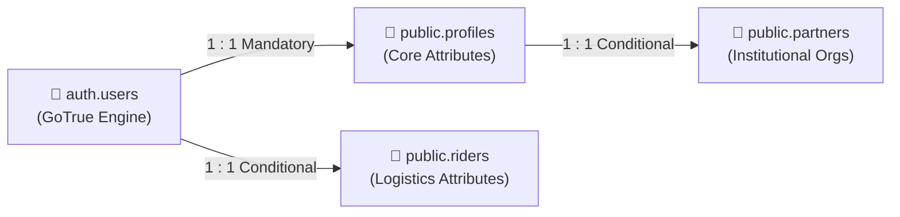
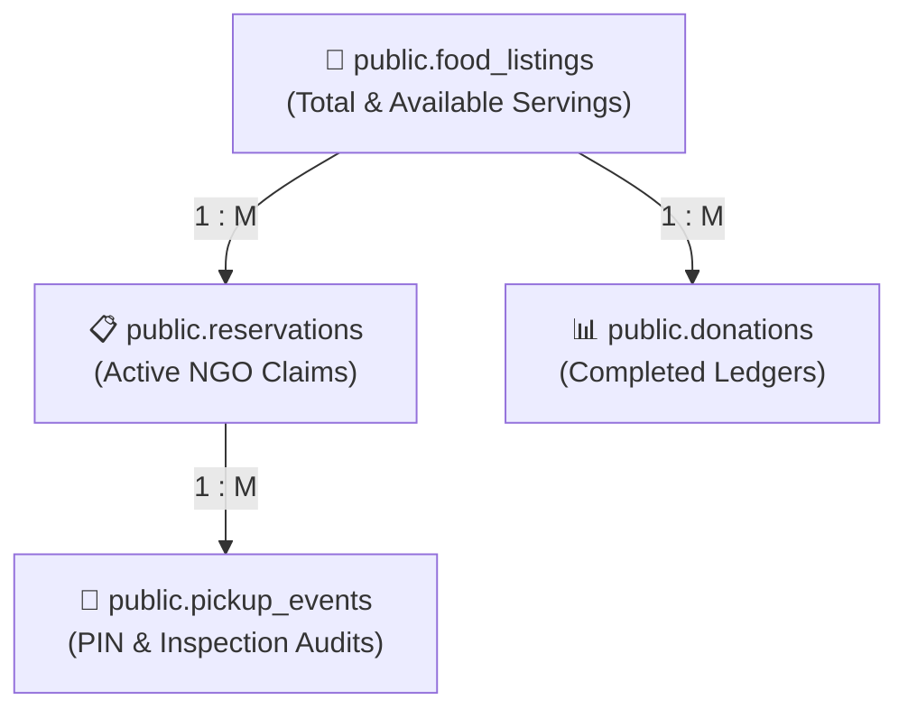
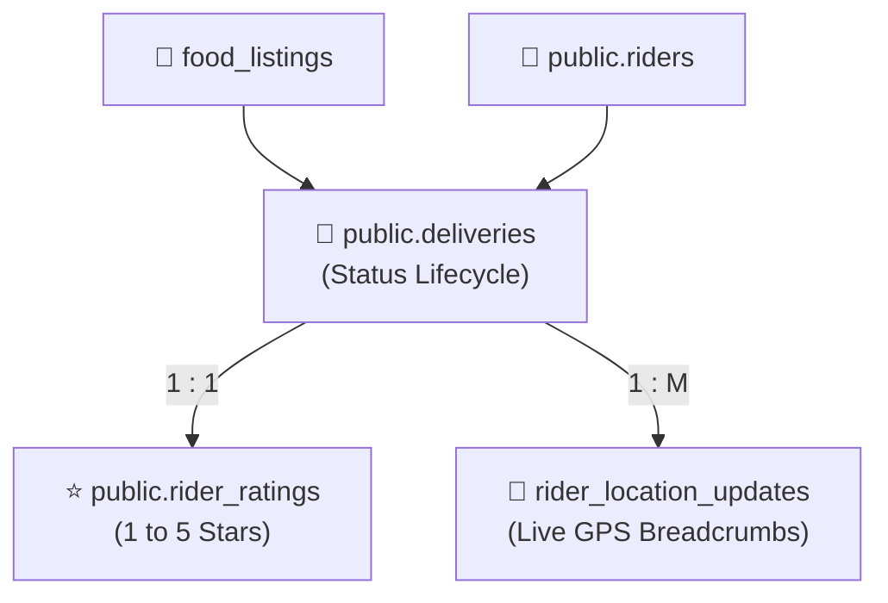
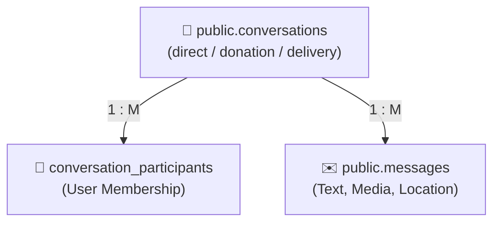
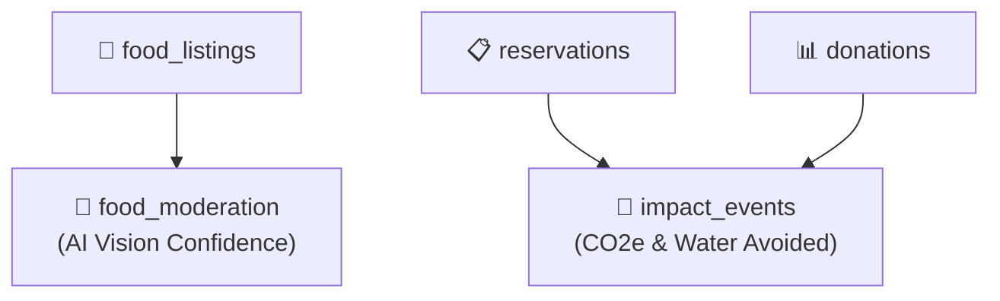

# 📊 Sharebite — Complete Database Schema & Entity-Relationship (ER) Specification

> **PostgreSQL 15 Canonical Schema Specification, Mermaid ER Topology, Constraints & Foreign Key DAG**  
> Covers 19 Relational Schemas, 34 Foreign Key Vectors, 7 Custom Enums, 27 Performance Indexes, and Automated Trigger Lifecycle Functions.

---

## 📋 Table of Contents

1. [Complete Entity-Relationship (ER) Diagram](#-1-complete-entity-relationship-er-diagram)
2. [Subsystem Relational Topology](#-2-subsystem-relational-topology)
   - 2.1 [Auth & Identity Subsystem](#21-auth--identity-subsystem)
   - 2.2 [Food Donation & Inventory Subsystem](#22-food-donation--inventory-subsystem)
   - 2.3 [Logistics, Deliveries & Riders Subsystem](#23-logistics-deliveries--riders-subsystem)
   - 2.4 [Real-Time Messaging Subsystem](#24-real-time-messaging-subsystem)
   - 2.5 [Auditing, Moderation & Impact Subsystem](#25-auditing-moderation--impact-subsystem)
3. [Foreign Key Dependency Tree (DAG)](#-3-foreign-key-dependency-tree-dag)
4. [Custom Enums & Type Definitions](#-4-custom-enums--type-definitions)
5. [Complete Table Data Dictionary (All 19 Tables)](#-5-complete-table-data-dictionary-all-19-tables)
6. [Cascade & Referential Integrity Rules](#-6-cascade--referential-integrity-rules)

---

## 🗄️ 1. Complete Entity-Relationship (ER) Diagram

```mermaid
erDiagram
    auth_users ||--|| profiles : "extends (1:1)"
    auth_users ||--o| riders : "registers as rider (1:1)"
    profiles ||--o| partners : "verifies org (1:1)"
    profiles ||--o{ food_listings : "creates (1:M)"
    profiles ||--o{ reservations : "claims (1:M)"
    profiles ||--o{ donations : "tracks (1:M)"
    profiles ||--o{ favorites : "bookmarks (1:M)"
    profiles ||--o{ notifications : "receives (1:M)"
    profiles ||--o{ impact_events : "earns (1:M)"
    profiles ||--o{ reports : "submits/subject of (1:M)"
    profiles ||--o{ conversation_participants : "joins (1:M)"
    profiles ||--o{ messages : "sends (1:M)"
    profiles ||--o{ volunteer_tasks : "assigned to (1:M)"
    
    food_listings ||--o{ reservations : "allocated in (1:M)"
    food_listings ||--o{ donations : "records (1:M)"
    food_listings ||--o{ favorites : "favorited in (1:M)"
    food_listings ||--o{ deliveries : "dispatched in (1:M)"
    food_listings ||--o{ food_moderation : "screened in (1:M)"
    food_listings ||--o{ conversations : "context for (1:M)"
    
    reservations ||--o{ pickup_events : "handover history (1:M)"
    reservations ||--o{ impact_events : "triggers (1:M)"
    
    riders ||--o{ deliveries : "executes (1:M)"
    riders ||--o{ rider_ratings : "receives (1:M)"
    
    deliveries ||--o{ rider_ratings : "rated by (1:1)"
    deliveries ||--o{ rider_location_updates : "tracks GPS (1:M)"
    
    conversations ||--o{ conversation_participants : "has members (1:M)"
    conversations ||--o{ messages : "contains (1:M)"

    profiles {
        uuid id PK "FK -> auth.users.id"
        text full_name
        text email
        text phone
        text avatar_url
        user_role role
        text address
        text city
        float latitude
        float longitude
        boolean is_verified
        int total_donations
        int total_rescues
        timestamptz created_at
        timestamptz updated_at
    }

    food_listings {
        uuid id PK
        uuid donor_id FK "-> profiles.id"
        text title
        text category
        text food_type
        text packaging_type
        int servings
        int available_servings
        text image_url
        text pickup_address
        text city
        float latitude
        float longitude
        timestamptz available_from
        timestamptz available_until
        food_status status
        boolean is_urgent
        text moderation_status
        text image_hash
        timestamptz created_at
        timestamptz updated_at
    }

    reservations {
        uuid id PK
        uuid food_listing_id FK "-> food_listings.id"
        uuid user_id FK "-> profiles.id"
        int servings
        reservation_status status
        timestamptz pickup_time
        text notes
        timestamptz created_at
        timestamptz updated_at
    }

    donations {
        uuid id PK
        uuid food_listing_id FK "-> food_listings.id"
        uuid donor_id FK "-> profiles.id"
        int servings
        text status
        timestamptz created_at
        timestamptz completed_at
    }

    riders {
        uuid id PK
        uuid user_id FK "-> auth.users.id (UNIQUE)"
        text name
        text phone
        vehicle_type vehicle_type
        text vehicle_number
        boolean id_verified
        float current_lat
        float current_lng
        boolean is_online
        boolean is_available
        numeric rating
        int total_deliveries
        int total_earnings
        timestamptz created_at
    }

    deliveries {
        uuid id PK
        uuid food_post_id FK "-> food_listings.id"
        uuid donor_id FK "-> auth.users.id"
        uuid receiver_id FK "-> auth.users.id"
        uuid rider_id FK "-> riders.id"
        float pickup_lat
        float pickup_lng
        text pickup_address
        float drop_lat
        float drop_lng
        text drop_address
        text food_name
        delivery_status status
        text pickup_pin_hash
        timestamptz rider_assigned_at
        timestamptz picked_up_at
        timestamptz delivered_at
        timestamptz completed_at
    }

    rider_ratings {
        uuid id PK
        uuid delivery_id FK "-> deliveries.id"
        uuid rider_id FK "-> riders.id"
        uuid rater_id FK "-> auth.users.id"
        smallint rating "1 to 5"
        text comment
        timestamptz created_at
    }

    rider_location_updates {
        uuid id PK
        uuid rider_id FK "-> riders.id"
        uuid delivery_task_id FK "-> deliveries.id"
        float latitude
        float longitude
        float heading
        float speed
        timestamptz recorded_at
    }

    conversations {
        uuid id PK
        text type "direct / donation / delivery"
        uuid related_listing_id FK "-> food_listings.id"
        uuid related_task_id
        text title
        timestamptz last_message_at
        timestamptz created_at
    }

    conversation_participants {
        uuid id PK
        uuid conversation_id FK "-> conversations.id"
        uuid user_id FK "-> profiles.id"
        text role
        timestamptz last_read_at
    }

    messages {
        uuid id PK
        uuid conversation_id FK "-> conversations.id"
        uuid sender_id FK "-> profiles.id"
        text content
        text message_type "text/image/location/system"
        jsonb metadata
        boolean is_read
        timestamptz created_at
    }

    food_moderation {
        uuid id PK
        uuid food_post_id FK "-> food_listings.id"
        uuid user_id FK "-> auth.users.id"
        text image_url
        text image_hash
        moderation_status moderation_status
        text ai_decision
        boolean is_food
        boolean is_spam
        numeric quality_score
        numeric confidence
        text ai_reason
        text[] ai_labels
        uuid duplicate_of FK "-> food_moderation.id"
        timestamptz moderated_at
    }

    notifications {
        uuid id PK
        uuid user_id FK "-> profiles.id"
        notification_type type
        text title
        text message
        jsonb data
        uuid related_food_id FK "-> food_listings.id"
        uuid related_reservation_id FK "-> reservations.id"
        boolean is_read
        timestamptz created_at
    }

    impact_events {
        uuid id PK
        uuid user_id FK "-> profiles.id"
        uuid reservation_id FK "-> reservations.id"
        uuid donation_id FK "-> donations.id"
        text event_type
        int servings
        timestamptz created_at
    }

    partners {
        uuid id PK
        uuid profile_id FK "-> profiles.id (UNIQUE)"
        text organization_name
        text organization_type
        text address
        text city
        boolean is_verified
        timestamptz created_at
    }

    volunteer_tasks {
        uuid id PK
        text title
        text task_type
        text status
        uuid ngo_id FK "-> profiles.id"
        uuid donation_id FK "-> food_listings.id"
        uuid assigned_volunteer_id FK "-> profiles.id"
        jsonb pickup_location
        jsonb dropoff_location
        int points_reward
        timestamptz scheduled_time
    }

    reports {
        uuid id PK
        uuid reporter_id FK "-> profiles.id"
        uuid food_listing_id FK "-> food_listings.id"
        uuid reported_user_id FK "-> profiles.id"
        text reason
        text status
        timestamptz created_at
    }

    favorites {
        uuid id PK
        uuid user_id FK "-> profiles.id"
        uuid food_listing_id FK "-> food_listings.id"
        timestamptz created_at
    }

    pickup_events {
        uuid id PK
        uuid reservation_id FK "-> reservations.id"
        uuid performed_by FK "-> profiles.id"
        text event_type
        text notes
        timestamptz created_at
    }
```



---

## 🧩 2. Subsystem Relational Topology

### 2.1 Auth & Identity Subsystem
Governs user onboarding, authentication, role assignment, and organization affiliations.



- **Trigger Binding**: Insertion into `auth.users` fires the `handle_new_user()` trigger to immediately seed `public.profiles`.
- **Inheritance Pattern**: `riders` and `partners` maintain 1:1 foreign keys back to `auth.users` or `profiles`, avoiding wide sparse tables.

---

### 2.2 Food Donation & Inventory Subsystem
Manages listing creation, servings decrements, and claims locking.



- **Inventory Integrity Rule**: `available_servings <= servings` checked via SQL constraints.
- **Atomic Locking**: Claiming executes via `claim_food_atomic()` RPC using `SELECT ... FOR UPDATE` mutex on `food_listings`.

---

### 2.3 Logistics, Deliveries & Riders Subsystem
Coordinates delivery task dispatches, real-time GPS locations, and post-delivery ratings.



---

### 2.4 Real-Time Messaging Subsystem
Provides in-app conversation channels linking donors, NGOs, and delivery riders.



---

### 2.5 Auditing, Moderation & Impact Subsystem
Calculates public environmental impact, screens photos for compliance, and logs notifications.



---

## 🌲 3. Foreign Key Dependency Tree (DAG)

When deploying or recreating migrations, tables must be constructed in this exact Topological Order:

```
Level 0 (Root Authentication):
  └── auth.users

Level 1 (Direct Dependents on Auth):
  ├── public.profiles
  └── public.riders

Level 2 (Dependents on Profiles):
  ├── public.partners
  ├── public.food_listings
  └── public.volunteer_tasks

Level 3 (Dependents on Food Listings):
  ├── public.donations
  ├── public.reservations
  ├── public.favorites
  ├── public.deliveries
  ├── public.conversations
  ├── public.food_moderation
  └── public.reports

Level 4 (Dependents on Claims & Deliveries):
  ├── public.pickup_events
  ├── public.rider_ratings
  ├── public.rider_location_updates
  ├── public.conversation_participants
  ├── public.messages
  ├── public.notifications
  └── public.impact_events
```

---

## 🔡 4. Custom Enums & Type Definitions

| Enum Type | Values | Used In Table(s) |
|:---|:---|:---|
| `user_role` | `'donor'`, `'receiver'`, `'volunteer'`, `'ngo'`, `'partner'`, `'admin'`, `'rider'`, `'household'` | `profiles.role` |
| `food_status` | `'available'`, `'reserved'`, `'partially_reserved'`, `'picked_up'`, `'completed'`, `'expired'`, `'cancelled'` | `food_listings.status` |
| `reservation_status` | `'pending'`, `'confirmed'`, `'ready_for_pickup'`, `'picked_up'`, `'completed'`, `'cancelled'`, `'expired'` | `reservations.status` |
| `delivery_status` | `'SEARCHING_RIDER'`, `'RIDER_ASSIGNED'`, `'GOING_TO_PICKUP'`, `'FOOD_PICKED_UP'`, `'GOING_TO_DROPOFF'`, `'DELIVERED'`, `'COMPLETED'`, `'CANCELLED'` | `deliveries.status` |
| `vehicle_type` | `'bike'`, `'motorcycle'`, `'bicycle'`, `'scooter'`, `'car'` | `riders.vehicle_type` |
| `moderation_status` | `'pending'`, `'approved'`, `'rejected'`, `'manual_review'` | `food_moderation.moderation_status` |
| `notification_type` | `'reservation_created'`, `'reservation_confirmed'`, `'pickup_ready'`, `'pickup_completed'`, `'donation_created'`, `'donation_completed'`, `'listing_expiring'`, `'partner_verified'`, `'system'`, `'new_donation'`, `'donation_claimed'`, `'pickup_confirmed'`, `'donation_expiring'`, `'verification_update'`, `'impact_milestone'`, `'rider_assigned'`, `'delivery_completed'` | `notifications.type` |

---

## 📖 5. Complete Table Data Dictionary (All 19 Tables)

### Summary Metrics of Database Design
- **Total Tables**: 19
- **Total Custom Enums**: 7
- **Foreign Key Constraints**: 34
- **Performance Indexes**: 27
- **Database Triggers**: 10 (Auto `updated_at` + Auto `handle_new_user`)

---

## 🔒 6. Cascade & Referential Integrity Rules

| Parent Table | Child Table | Foreign Key Column | On Delete Action | Security Rationale |
|:---|:---|:---|:---|:---|
| `auth.users` | `profiles` | `id` | **CASCADE** | GDPR & DPDP compliance; account deletion wipes personal profile |
| `auth.users` | `riders` | `user_id` | **CASCADE** | Deleting account deletes driver records |
| `profiles` | `food_listings` | `donor_id` | **CASCADE** | Deleting donor purges their unfulfilled listings |
| `food_listings` | `reservations` | `food_listing_id` | **CASCADE** | Deleting listing cancels pending reservations |
| `food_listings` | `deliveries` | `food_post_id` | **SET NULL** | Retains logistics billing history even if food post is removed |
| `conversations` | `messages` | `conversation_id` | **CASCADE** | Deleting chat room deletes message logs |
| `deliveries` | `rider_ratings` | `delivery_id` | **CASCADE** | Removing delivery purges tied ratings |
| `reservations` | `pickup_events` | `reservation_id` | **CASCADE** | Handover PIN history removed upon reservation purge |

---

*Sharebite Database Architecture — PostgreSQL 15 | Canonical Schema v3.2 | November 2026*