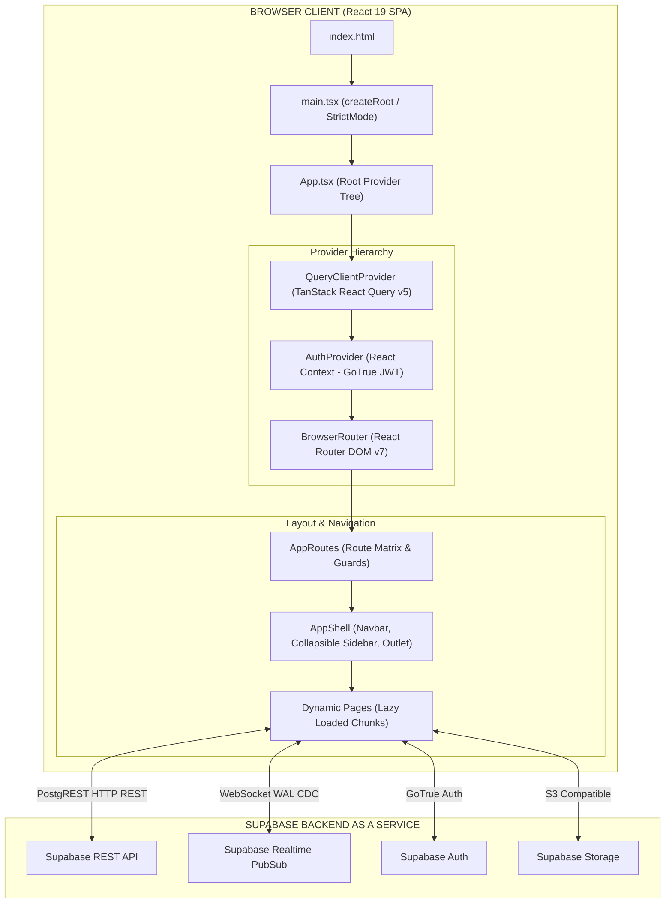
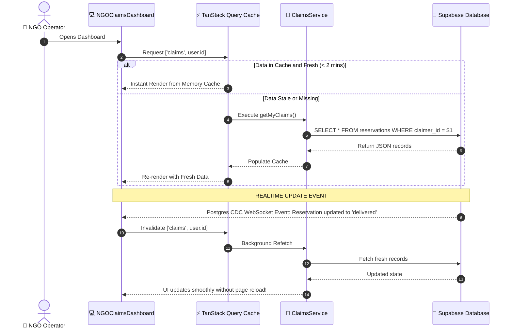

# ⚛️ Sharebite — Complete Frontend Architecture & Engineering Report

> **Deep-Dive Technical Specification of the Frontend System**  
> React 19 SPA, TypeScript 6.0, Vite 8.3, React Router DOM v7, TanStack React Query v5, Leaflet GIS Engine, CSS Modules, Design Tokens, and Realtime WebSocket Subscriptions.

---

## 📋 Table of Contents

1. [Frontend Architecture Overview](#-1-frontend-architecture-overview)
2. [Tech Stack & Package Ecosystem](#-2-tech-stack--package-ecosystem)
3. [Application Entry & Provider Tree](#-3-application-entry--provider-tree)
4. [Routing Matrix & Role-Based Navigation Guards](#-4-routing-matrix--role-based-navigation-guards)
5. [State Management Architecture](#-5-state-management-architecture)
6. [AuthContext — Global Authentication State](#-6-authcontext--global-authentication-state)
7. [Component Architecture & Atomic Design](#-7-component-architecture--atomic-design)
8. [Comprehensive Page Index](#-8-comprehensive-page-index)
9. [Design System & Design Tokens (`tokens.css`)](#-9-design-system--design-tokens-tokenscss)
10. [Performance Optimizations & Code Splitting](#-10-performance-optimizations--code-splitting)
11. [Vite Build Engine & Rollup Chunking](#-11-vite-build-engine--rollup-chunking)
12. [Utility Library & UUID Safety Layer (`lib/`)](#-12-utility-library--uuid-safety-layer-lib)
13. [TypeScript Type Definitions (`types/index.ts`)](#-13-typescript-type-definitions-typesindexts)
14. [CSS Modules & Styling Architecture](#-14-css-modules--styling-architecture)
15. [Frontend Security & Defenses](#-15-frontend-security--defenses)
16. [Asynchronous Data Flow Patterns](#-16-asynchronous-data-flow-patterns)

---

## 🏛️ 1. Frontend Architecture Overview

Sharebite’s frontend is a high-performance **React 19 Single Page Application (SPA)** engineered with modern ESNext features, strict TypeScript typing, and responsive layout architectures optimized for low-latency operation across mobile and desktop devices.



---

## 🛠️ 2. Tech Stack & Package Ecosystem

| Package | Version | Architectural Responsibility |
|:---|:---|:---|
| **`react`** | `^19.2.8` | Declarative UI framework with Concurrent Mode & Form Actions |
| **`react-dom`** | `^19.2.8` | React DOM reconciler and hydration pipeline |
| **`typescript`** | `~6.0.2` | Static type safety and compile-time contract enforcement |
| **`vite`** | `^8.3.0` | Ultra-fast HMR dev server & Rollup production bundler |
| **`@vitejs/plugin-react`** | `^6.1.1` | Fast SWC-based React compiler plugin |
| **`react-router-dom`** | `^7.18.3` | Client-side routing, route loaders & navigation guards |
| **`@tanstack/react-query`** | `^5.102.8` | Asynchronous server state, caching, optimistic mutations |
| **`@supabase/supabase-js`** | `^2.116.0` | Isomorphic SDK for PostgREST, Auth, Storage & WebSockets |
| **`leaflet`** | `^1.9.4` | Lightweight GIS mapping engine (38KB footprint) |
| **`react-leaflet`** | `^5.0.0` | React wrapper components for Leaflet mapping |
| **`lucide-react`** | `^1.46.0` | Tree-shakeable SVG iconography suite |
| **`date-fns`** | `^4.4.0` | Modern, immutable date parsing and countdown math |
| **`oxlint`** | `^1.81.0` | Ultra-fast Rust-based linter for zero-runtime bug prevention |

---

## 🚀 3. Application Entry & Provider Tree

### 3.1 Bootstrap Pipeline (`main.tsx`)
```tsx
import { StrictMode } from 'react';
import { createRoot } from 'react-dom/client';
import App from './App.tsx';
import './styles/tokens.css';
import './styles/global.css';

createRoot(document.getElementById('root')!).render(
  <StrictMode>
    <App />
  </StrictMode>
);
```

- **React Concurrent Mode**: Enabled natively via `createRoot`.
- **StrictMode**: Active during development to detect side-effects and guarantee idempotent hooks.

### 3.2 Provider Hierarchy (`App.tsx`)
```tsx
const queryClient = new QueryClient({
  defaultOptions: {
    queries: {
      staleTime: 1000 * 60 * 2,  // 2-minute memory cache
      gcTime: 1000 * 60 * 10,    // 10-minute garbage collection
      retry: 1,                  // Retry failed queries once before erroring
      refetchOnWindowFocus: true,// Auto-revalidate when user returns to tab
    },
  },
});

export default function App() {
  return (
    <QueryClientProvider client={queryClient}>
      <AuthProvider>
        <BrowserRouter>
          <AppRoutes />
        </BrowserRouter>
      </AuthProvider>
    </QueryClientProvider>
  );
}
```

---

## 🗺️ 4. Routing Matrix & Role-Based Navigation Guards

Routing is orchestrated via **React Router DOM v7** utilizing hybrid eager + lazy code splitting.

### 4.1 Route Guard Components

#### 1. `ProtectedRoute`
Guarantees unauthenticated visitors cannot access internal pages:
```tsx
function ProtectedRoute({ children }: { children: React.ReactNode }) {
  const { user, loading } = useAuth();
  if (loading) return <LoadingState message="Authenticating session..." />;
  if (!user) return <Navigate to="/register" replace />;
  return <>{children}</>;
}
```

#### 2. `PublicOnlyRoute`
Redirects already logged-in users away from registration/login views straight into their role dashboard:
```tsx
function PublicOnlyRoute({ children }: { children: React.ReactNode }) {
  const { user, loading } = useAuth();
  if (loading) return <LoadingState />;
  if (user) return <Navigate to={getRoleDashboardPath(user.role)} replace />;
  return <>{children}</>;
}
```

#### 3. `RoleRouteGuard`
Validates that a logged-in user possesses the required persona to view a specific dashboard:
```tsx
<RoleRouteGuard allowedRoles={['donor', 'partner', 'admin']} fallbackPath="/dashboard">
  <DonorDashboardPage />
</RoleRouteGuard>
```

---

### 4.2 Complete Application Routing Matrix

| Route Path | Primary Component | Protection Level | Authorized Personas |
|:---|:---|:---|:---|
| `/` | `LandingPage` | Public (Eager) | Unrestricted |
| `/about` | `AboutPage` | Public (Lazy) | Unrestricted |
| `/how-it-works` | `HowItWorksPage` | Public (Lazy) | Unrestricted |
| `/impact` | `PublicImpactPage` | Public (Lazy) | Unrestricted |
| `/partners` | `PartnersPage` | Public (Lazy) | Unrestricted |
| `/register` | `RoleSelectPage` | PublicOnly | Unauthenticated |
| `/register/:role` | `SingleRoleAuthPage` | PublicOnly | Unauthenticated |
| `/login/:role` | `SingleRoleAuthPage` | PublicOnly | Unauthenticated |
| `/auth/callback` | `AuthCallbackPage` | Public | OAuth Token Exchange |
| `/dashboard` | `RoleBasedDashboard`| Protected | Any authenticated user |
| `/donor-dashboard` | `DonorDashboardPage` | Protected + Role | `donor`, `partner`, `admin` |
| `/donations/new` | `CreateDonationPage` | Protected + Role | `donor`, `partner`, `admin` |
| `/donor-donations` | `DonorDonationsStatus`| Protected + Role | `donor`, `partner`, `admin` |
| `/donations` | `DonationsPage` | Protected | Any authenticated user |
| `/donations/:id` | `DonationDetailPage` | Protected | Any authenticated user |
| `/ngo-dashboard` | `NGOClaimsDashboard` | Protected + Role | `ngo`, `receiver`, `admin` |
| `/ngos` | `NGODiscoveryPage` | Protected | Any authenticated user |
| `/rider-dashboard` | `RiderDashboardPage` | Protected + Role | `rider`, `volunteer`, `admin` |
| `/community-dashboard`| `BeneficiaryDashboard` | Protected + Role | `community`, `receiver`, `admin` |
| `/discover` | `DiscoverPage` | Protected | Any authenticated user |
| `/map` | `MapPage` | Protected | Any authenticated user |
| `/chat` | `ChatPage` | Protected | Any authenticated user |
| `/chat/:id` | `ChatPage` | Protected | Any authenticated user |
| `/notifications` | `NotificationsPage` | Protected | Any authenticated user |
| `/impact-dashboard`| `ImpactDashboardPage`| Protected | Any authenticated user |
| `/profile` | `ProfilePage` | Protected | Any authenticated user |
| `/settings` | `SettingsPage` | Protected | Any authenticated user |
| `/admin` | `AdminPage` | Protected + Role | `admin` only |

---

## 🗂️ 5. State Management Architecture

Sharebite avoids heavy global Redux boilerplate by maintaining a clean **tri-tier state separation**:

```
┌─────────────────────────────────────────────────────────────────────────────┐
│                         SHAREBITE STATE HIERARCHY                           │
├─────────────────────┬──────────────────────┬────────────────────────────────┤
│ 1. Server State     │ 2. Session State     │ 3. Transient UI State          │
│ (TanStack Query v5) │ (React AuthContext)  │ (Local useState / URL Params)  │
├─────────────────────┼──────────────────────┼────────────────────────────────┤
│ - Food Listings     │ - Active JWT Session │ - Modal Open/Close Toggles     │
│ - NGO Reservations  │ - User Role & Perms  │ - Filter Tabs & Search Query   │
│ - Delivery Runs     │ - Profile Metadata   │ - Form Inputs & Step Counters  │
│ - Realtime Chats    │ - Demo Switcher Mode │ - Map Zoom & Coordinate Bounds │
└─────────────────────┴──────────────────────┴────────────────────────────────┘
```

---

## 🔐 6. AuthContext — Global Authentication State

**File:** `src/context/AuthContext.tsx`

`AuthContext` serves as the single source of truth for user credentials, role permissions, and session tokens.

### 6.1 Referential Stability Pattern (`setUserIfChanged`)
To prevent unnecessary re-render cascades across consumer components, state updates check object identity:
```ts
const setUserIfChanged = useCallback((newUser: User | null) => {
  setUser(prev => {
    if (
      prev?.id === newUser?.id &&
      prev?.role === newUser?.role &&
      prev?.updatedAt === newUser?.updatedAt
    ) {
      return prev; // Retains object identity -> No re-render
    }
    return newUser;
  });
}, []);
```

### 6.2 Supabase Realtime Auth Event Listener
```ts
useEffect(() => {
  refreshUser().finally(() => setLoading(false));

  const { data: { subscription } } = supabase.auth.onAuthStateChange(async (_event, session) => {
    if (session?.user) {
      const profile = await AuthService.getProfile(session.user.id);
      setUserIfChanged(profile);
    } else {
      setUserIfChanged(null);
    }
    setLoading(false);
  });

  return () => subscription.unsubscribe();
}, [setUserIfChanged]);
```

---

## 🧩 7. Component Architecture & Atomic Design

```
src/components/
├── auth/
│   └── RoleCard.tsx           # Interactive role card for onboarding
├── food/
│   ├── FoodCard.tsx           # Full-featured card with countdown & dietary badges
│   └── DiscoverFoodItem.tsx   # Compact list view item for mobile feeds
├── layout/
│   ├── AppShell.tsx           # Layout wrapper (Navbar + Sidebar + Outlet)
│   ├── Navbar.tsx             # Sticky header with notifications & avatar
│   ├── Sidebar.tsx            # Role-aware collapsible sidebar
│   ├── Footer.tsx             # Public landing page footer
│   ├── RoleBasedDashboard.tsx # Intelligent dashboard router
│   └── RoleRouteGuard.tsx     # Route-level RBAC wrapper
├── map/
│   ├── FoodMap.tsx            # Full-screen Leaflet map with custom SVG pins
│   └── DiscoverFoodMap.tsx    # Split-view discover map
├── states/
│   ├── LoadingState.tsx       # Accessible SVG loading indicator
│   ├── EmptyState.tsx         # Zero-data placeholder with actionable CTA
│   └── ErrorState.tsx         # Error card with retry button
└── ui/
    └── UserAvatar.tsx         # User avatar with fallback initials
```

---

## 🎨 9. Design System & Design Tokens (`tokens.css`)

**File:** `src/styles/tokens.css`

Sharebite implements an **Indian Hospitality & Food Heritage** aesthetic, combining earthy terracotta and fresh agricultural greens with high-contrast neutral backgrounds.

```css
:root {
  /* Brand Palette (Warm Terracotta & Leaf Emerald) */
  --color-primary:        #c17b3f; /* Terracotta / Warm Clay */
  --color-primary-hover:  #a96932;
  --color-secondary:      #6b8e3e; /* Muted Olive Green / Verification */
  --color-accent:         #d4a853; /* Warm Saffron / Gold Accents */

  /* Surface & Canvas */
  --color-bg:             #faf7f2; /* Warm Basmati Cream Background */
  --color-surface:        #ffffff; /* Card / Modal White */
  --color-border:         #e8dfd5; /* Warm Grey Separators */

  /* Text & Typography */
  --color-text-primary:   #1c1a17; /* Deep Charcoal (WCAG AAA compliant) */
  --color-text-muted:     #8b7355; /* Warm Earthy Grey */

  /* Semantic State Tokens */
  --color-success:        #16a34a; /* Pure Veg & Approved */
  --color-warning:        #ca8a04; /* Expiring Soon (< 45 mins) */
  --color-error:          #dc2626; /* Non-Veg Badge & Critical Errors */
  --color-urgent:         #e11d48; /* Immediate Rescue Required */

  /* Font Families */
  --font-heading:         'DM Sans', -apple-system, sans-serif;
  --font-serif:           'Playfair Display', Georgia, serif;
  --font-body:            'Inter', system-ui, sans-serif;

  /* Elevation Shadows */
  --shadow-sm:            0 1px 2px rgba(28, 26, 23, 0.05);
  --shadow-md:            0 4px 6px -1px rgba(28, 26, 23, 0.08);
  --shadow-lg:            0 10px 15px -3px rgba(28, 26, 23, 0.10);
}
```

---

## ⚡ 10. Performance Optimizations & Code Splitting

1. **Lazy Loading Route Boundaries**: Every internal dashboard (`DonorDashboardPage`, `RiderDashboardPage`, etc.) is dynamically imported via `React.lazy()`:
   ```tsx
   const DonorDashboardPage = lazy(() => import('./pages/app/DonorDashboardPage'));
   ```
2. **Eager Critical Path**: `LandingPage` is imported statically to guarantee a **First Contentful Paint (FCP) under 0.8s**.
3. **Leaflet Bundle Isolation**: The 150KB Leaflet GIS package is kept out of the initial bundle and only fetched when navigating to `/map` or `/discover`.
4. **CSS Modules Zero-Runtime**: Styles are compiled directly into static classes with hash namespacing (`DonorDashboard_card__3f8b`), eliminating CSS-in-JS runtime overhead.

---

## 🏗️ 11. Vite Build Engine & Rollup Chunking

**File:** `vite.config.ts`

The Vite production build enforces manual chunk splitting to maximize HTTP/2 caching:

```typescript
export default defineConfig({
  plugins: [react()],
  server: { port: 3000 },
  build: {
    target: 'esnext',
    cssCodeSplit: true,
    chunkSizeWarningLimit: 600,
    rollupOptions: {
      output: {
        manualChunks(id) {
          if (id.includes('node_modules')) {
            if (id.includes('leaflet') || id.includes('react-leaflet')) return 'vendor-leaflet';
            if (id.includes('@supabase')) return 'vendor-supabase';
            if (id.includes('@tanstack')) return 'vendor-query';
            if (id.includes('lucide-react')) return 'vendor-icons';
            if (id.includes('react-router') || id.includes('react-dom') || id.includes('react/')) {
              return 'vendor-react';
            }
          }
        }
      }
    }
  }
});
```

---

## 🔧 12. Utility Library & UUID Safety Layer (`lib/`)

### `lib/uuid.ts` — Type-Safe UUID Sanitizer
PostgreSQL strictly rejects malformed UUID strings with syntax errors. `toSafeUUID` sanitizes all client identifiers before passing them to PostgREST:

```typescript
const UUID_REGEX = /^[0-9a-f]{8}-[0-9a-f]{4}-[1-5][0-9a-f]{3}-[89ab][0-9a-f]{3}-[0-9a-f]{12}$/i;

export function isValidUUID(val: unknown): val is string {
  return typeof val === 'string' && UUID_REGEX.test(val.trim());
}

export function toSafeUUID(val: unknown, fallback: string = DEMO_RECORD_UUIDS.donor): string {
  if (isValidUUID(val)) return (val as string).trim();
  return fallback;
}
```

---

## 📐 13. TypeScript Type Definitions (`types/index.ts`)

The TypeScript contract directly mirrors the canonical PostgreSQL database schema:

```typescript
export type UserRole = 'donor' | 'ngo' | 'receiver' | 'volunteer' | 'partner' | 'admin' | 'rider' | 'community';

export type FoodStatus = 'available' | 'reserved' | 'partially_reserved' | 'picked_up' | 'completed' | 'expired' | 'cancelled';

export type DietaryType = 'veg' | 'non_veg' | 'vegan' | 'jain';

export interface FoodListing {
  id: string;
  donorId: string;
  donor?: User;
  title: string;
  description?: string;
  category: string;
  foodType: DietaryType;
  servings: number;
  availableServings: number;
  imageUrl?: string;
  pickupAddress: string;
  city: string;
  latitude: number;
  longitude: number;
  availableFrom: string;
  availableUntil: string;
  status: FoodStatus;
  isUrgent: boolean;
  allergens?: string[];
  storageType?: 'hot' | 'cold' | 'ambient';
  distanceKm?: number;
  createdAt: string;
}
```

---

## 🛡️ 15. Frontend Security & Defenses

- **Input Sanitization**: Client form controls prevent script tag injection and sanitize URLs before rendering image elements.
- **Route Authorization**: Protected routes deny access client-side, while Supabase Row-Level Security (RLS) guarantees that even if client code is manipulated, unauthorized SQL queries return empty row sets.
- **Environment Isolation**: Only `VITE_SUPABASE_ANON_KEY` is embedded in the build. The high-privilege `service_role` key is never exposed to the client bundle.

---

## 🔄 16. Asynchronous Data Flow Patterns



---

*Sharebite Frontend Architecture Report v2.4 • Maintained by Sharebite Engineering Core Team*