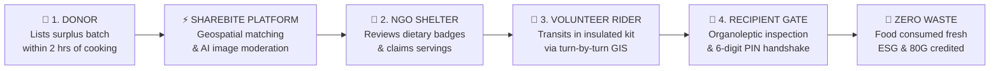
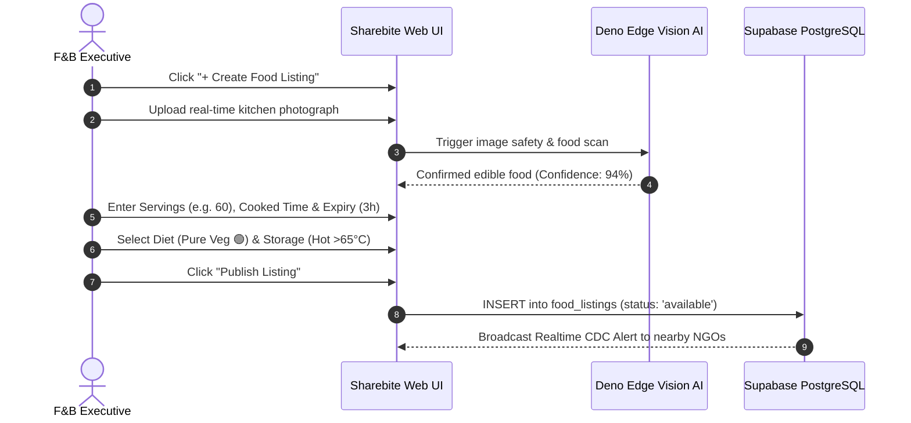
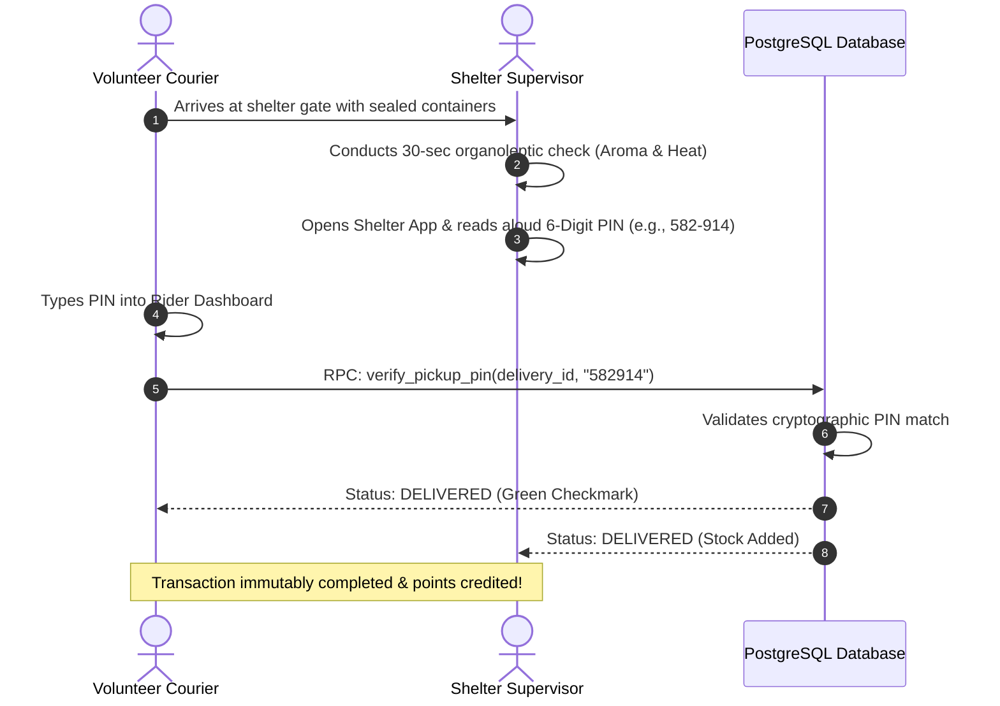
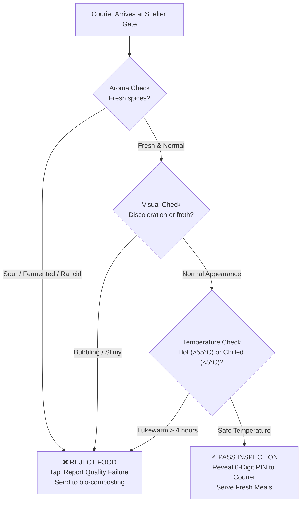

# 📖 Sharebite — Complete User & Operational Manual (SOP)

> **Official Standard Operating Procedures (SOP)**, role-specific UI walkthroughs, food hygiene inspection protocols, 6-digit verification PIN handshakes, and emergency response workflows for Donors, Volunteer Couriers, NGOs/Shelters, and Platform Administrators.

---

## 📋 Table of Contents

1. [Executive Overview & Platform Lifecycle](#-1-executive-overview--platform-lifecycle)
2. [Donor Operator Manual (Hotels, Banquets & Caterers)](#-2-donor-operator-manual-hotels-banquets--caterers)
   - 2.1 [Onboarding & Kitchen Verification](#21-onboarding--kitchen-verification)
   - 2.2 [Step-by-Step Food Listing Walkthrough (`CreateDonationPage`)](#22-step-by-step-food-listing-walkthrough-createdonationpage)
   - 2.3 [Dietary Badging & Mandatory Allergen Declarations](#23-dietary-badging--mandatory-allergen-declarations)
   - 2.4 [FSSAI Packaging, Sealing & Temperature Protocols](#24-fssai-packaging-sealing--temperature-protocols)
   - 2.5 [Courier Handoff Verification](#25-courier-handoff-verification)
   - 2.6 [Downloading 80G Tax Exemption & ESG Impact Audits](#26-downloading-80g-tax-exemption--esg-impact-audits)
3. [Volunteer Rider Manual (Rescue Couriers)](#-3-volunteer-rider-manual-rescue-couriers)
   - 3.1 [Courier Onboarding & Vehicle Kit Declaration](#31-courier-onboarding--vehicle-kit-declaration)
   - 3.2 [Mission Radar & Claiming Rescue Runs (`RiderDashboardPage`)](#32-mission-radar--claiming-rescue-runs-riderdashboardpage)
   - 3.3 [Kitchen Pickup & Physical Integrity Checklist](#33-kitchen-pickup--physical-integrity-checklist)
   - 3.4 [Transit Safety & Thermal Chain Preservation](#34-transit-safety--thermal-chain-preservation)
   - 3.5 [6-Digit Dynamic PIN Handshake at Shelter Gate](#35-6-digit-dynamic-pin-handshake-at-shelter-gate)
   - 3.6 [Offline Mode & Network Drop Procedures](#36-offline-mode--network-drop-procedures)
4. [NGO & Shelter Manual (Community Recipients)](#-4-ngo--shelter-manual-community-recipients)
   - 4.1 [Shelter Verification & Beneficiary Quota](#41-shelter-verification--beneficiary-quota)
   - 4.2 [Setting Proximity Alerts & Claiming Food (`NGOClaimsDashboard`)](#42-setting-proximity-alerts--claiming-food-ngoclaimsdashboard)
   - 4.3 [Mandatory Organoleptic Food Inspection (Smell / Sight / Heat)](#43-mandatory-organoleptic-food-inspection-smell--sight--heat)
   - 4.4 [Revealing Handshake PIN & Handover Confirmation](#44-revealing-handshake-pin--handover-confirmation)
   - 4.5 [Distribution Logging & Transparency Score](#45-distribution-logging--transparency-score)
5. [Platform Administrator Manual (`AdminPage`)](#-5-platform-administrator-manual-adminpage)
   - 5.1 [Mission Command Center & Live Operations](#51-mission-command-center--live-operations)
   - 5.2 [AI Vision Moderation Queue Resolution](#52-ai-vision-moderation-queue-resolution)
   - 5.3 [Dispute Arbitration & 3-Strike Safety Policy](#53-dispute-arbitration--3-strike-safety-policy)
   - 5.4 [City-Wide ESG & BRSR Carbon Report Export](#54-city-wide-esg--brsr-carbon-report-export)
6. [Emergency Protocols & Incident Response (SOP-911)](#-6-emergency-protocols--incident-response-sop-911)
7. [Progressive Web App (PWA) Mobile Setup Guide](#-7-progressive-web-app-pwa-mobile-setup-guide)
8. [Frequently Asked Questions (FAQ) by Role](#-8-frequently-asked-questions-faq-by-role)

---

## 🌟 1. Executive Overview & Platform Lifecycle

Sharebite coordinates time-sensitive food rescue across Indian urban clusters, connecting commercial surplus food generators with verified orphanages, shelters, and community kitchens.

---

## 🏨 2. Donor Operator Manual (Hotels, Banquets & Caterers)

### 2.1 Onboarding & Kitchen Verification
1. Navigate to `/signup` and select **"Food Donor / Commercial Partner"**.
2. **Kitchen Details**:
   - Enter **Commercial Trade Name** (e.g., *ITC Maurya Banquet Kitchen #3*).
   - Enter **FSSAI 14-Digit License Number** (Mandatory for hotels, restaurants, and cloud kitchens under the Food Safety and Standards Act, 2006).
   - Drop the exact **GPS Pin** on the interactive map for dispatch accuracy.
   - Enter **F&B Manager / Head Chef Emergency Mobile Number** for instant courier coordination.

---

### 2.2 Step-by-Step Food Listing Walkthrough (`CreateDonationPage`)

#### Detailed Form Input Specifications:

| Form Field | Recommended Value / Format | FSSAI Compliance Rule |
|:---|:---|:---|
| **Listing Title** | Specific (e.g., *"Dal Makhani & Jeera Pulao"*) | Do NOT use generic terms like *"Leftovers"*. |
| **Category** | Cooked Meals, Bakery, Produce, Packaged | Cooked gravies receive highest courier dispatch speed. |
| **Servings Count**| Integer (e.g., `50` meals) or Weight in Kg (`20` kg) | 1 Standard Adult Serving ≈ 350g–450g cooked mass. |
| **Cooking Timestamp**| Past 1 to 3 hours | Cooked food older than 4 hours without chilling is prohibited. |
| **Expiry Countdown** | Automatic (Default: 4 hours from prep) | System de-lists batch automatically upon reaching 0:00. |
| **Storage Temperature**| Hot Holding ($>65^\circ\text{C}$), Cold ($<4^\circ\text{C}$), Ambient | Dictates rider delivery equipment selection. |

---

### 2.3 Dietary Badging & Mandatory Allergen Declarations
Every listing must display transparent dietary labeling to respect cultural and dietary requirements:

- 🟢 **Pure Vegetarian (Green Dot)**: Contains zero meat, fish, poultry, or eggs. Dairy products permitted.
- 🟡 **Jain Compliant**: Pure vegetarian + strictly NO root crops (no onions, garlic, potatoes, carrots, radishes).
- 🔴 **Non-Vegetarian (Red/Brown Triangle)**: Poultry, meat, or fish. Must declare Halal certification if applicable.
- 🌾 **Allergen Alerts**: Check appropriate flags: `Gluten`, `Peanuts/Tree Nuts`, `Dairy/Lactose`, `Soybeans`.

---

### 2.4 FSSAI Packaging, Sealing & Temperature Protocols

> [!IMPORTANT]
> Under **FSSAI Surplus Food Regulations (2019)**, food that has been served on customer buffet plates is classified as waste and **CANNOT** be donated. Only untouched batch surplus from preparation vessels or unserved hot chafing pans is eligible.

1. **Packaging Materials**:
   - Heavy-gauge aluminum foil containers with crimped paperboard lids.
   - Food-grade, tamper-evident plastic tubs.
   - Stainless steel transport drums for curries and lentils (returned within 24 hours).
2. **Batch Labeling**:
   - Marker label on each lid: **Listing ID** (e.g., `#SB-4819`), **Cooking Time**, and **Diet Badge**.
3. **Thermal Holding**:
   - Hot food must be held in thermal insulated boxes at $>60^\circ\text{C}$ until rider handoff.
   - Cold items (salads, desserts) must remain refrigerated at $<5^\circ\text{C}$.

---

### 2.5 Courier Handoff Verification
1. When the assigned rider arrives, verify their **Rider Name** and **Vehicle Registration Number** against your live dashboard screen.
2. Confirm container seals are intact.
3. Tap **"Handed to Courier"** in your donor dashboard.
4. *Note:* **Do not ask for a PIN**. The 6-digit confirmation PIN belongs exclusively to the receiving shelter.

---

### 2.6 Downloading 80G Tax Exemption & ESG Impact Audits
1. Navigate to **Dashboard ➡️ Impact & Tax Exemption**.
2. Click **"Download Monthly 80G Consolidated Certificate"**: Legally accredited receipt enabling corporate income tax deductions under Section 80G of the Indian Income Tax Act, 1961.
3. Click **"Export SEBI BRSR ESG Report"**: Formatted PDF/CSV documenting avoided landfill tonnage, avoided methane emissions, and community meals served.

---

## 🛵 3. Volunteer Rider Manual (Rescue Couriers)

### 3.1 Courier Onboarding & Vehicle Kit Declaration
1. Register under **"Volunteer Courier / Rescue Rider"**.
2. **Vehicle Category**:
   - 🚴 **Bicycle / Foot Patrol**: Maximum 2.5 km radius | Maximum 8 kg payload.
   - 🛵 **Two-Wheeler (Motorcycle / EV Scooter)**: Maximum 12 km radius | Up to 25 kg payload (Insulated delivery bag mandatory).
   - 🚗 **Four-Wheeler / Electric Van**: Up to 35 km radius | Bulk banquet rescues (30 kg to 300 kg).
3. **Kit Verification**: Upload a clear photo of your insulated thermal delivery bag.

---

### 3.2 Mission Radar & Claiming Rescue Runs (`RiderDashboardPage`)
1. Open the **"Mission Radar"** on your smartphone.
2. Review run parameters:
   - **Donor Location & Distance** (e.g., *The Lalit Hotel — 1.8 km*).
   - **Destination Shelter** (e.g., *Bal Sahyog Children Home — 3.6 km*).
   - **Batch Volume** (e.g., *40 Servings Rice & Dal — 16 kg*).
   - **Delivery Deadline** (e.g., *Expires in 42 minutes*).
3. Swipe **"Accept Rescue Mission"**: The database locks the run exclusively to your account via row-level mutex.

---

### 3.3 Kitchen Pickup & Physical Integrity Checklist
Upon arrival at the donor's dispatch kitchen:
- [ ] Verify container lids are tightly sealed without oil seepage.
- [ ] Confirm food is warm/hot to the touch.
- [ ] Verify total container count matches the app manifest.
- [ ] Tap **"Confirm Pickup & Start Route"** to launch turn-by-turn navigation.

---

### 3.4 Transit Safety & Thermal Chain Preservation
- Place containers strictly upright inside the insulated carrier bag.
- Keep the thermal zipper closed throughout transit to prevent temperature loss or dust contamination.
- Follow in-app GPS routing directly without unscheduled intermediate stops.

---

### 3.5 6-Digit Dynamic PIN Handshake at Shelter Gate

> [!CAUTION]
> Never release food without entering the recipient's 6-digit PIN. The PIN is the only cryptographic proof that food reached genuine beneficiaries.

---

### 3.6 Offline Mode & Network Drop Procedures
In underground kitchens or low-reception shelter zones:
1. The Sharebite PWA caches your mission state locally in **IndexedDB**.
2. Type the recipient's PIN as usual: The app validates the local SHA-256 hash offline.
3. Once your mobile device reconnects to mobile data, the background sync worker flushes the completion event to the server automatically.

---

## 🏢 4. NGO & Shelter Manual (Community Recipients)

### 4.1 Shelter Verification & Beneficiary Quota
To prevent commercial diversion or black-marketing of donated meals:
1. Upload NGO Trust Deed / Society Registration Certificate.
2. Enter **NITI Aayog Darpan ID** (for Indian non-profits).
3. State verified beneficiary capacity (e.g., *85 resident children*, *140 elderly inmates*).
4. Specify dietary policies (e.g., *Strictly Pure Vegetarian & Jain Only*).

---

### 4.2 Setting Proximity Alerts & Claiming Food (`NGOClaimsDashboard`)
1. **Set Proximity Radius**: Define acceptable distance (default: 5 km to 10 km).
2. **Review Incoming Listings**:
   - Filter by badges: **Pure Veg 🟢**, **Jain 🟡**, **Halal 🔴**.
   - Check batch quantity against current dining headcount.
3. **Claim Servings**:
   - Use the slider to select exact servings needed (supports partial reservations).
   - Tap **"Confirm Claim"**: An atomic database transaction locks the servings instantly.

---

### 4.3 Mandatory Organoleptic Food Inspection (Smell / Sight / Heat)
Before sharing the PIN with the courier, the kitchen supervisor must conduct a **30-Second Organoleptic Quality Assessment**:

#### Inspection Decision Matrix:

| Inspection Attribute | Accept Criteria | Reject Criteria (Cancel & Quarantine) |
|:---|:---|:---|
| **Aroma / Odor** | Fresh, characteristic spices and gravy aroma. | Sour, fermented, stale, pungent, or rancid smell. |
| **Visual Appearance**| Uniform gravy, clear oil, no bubbles. | Surface froth, unusual bubbling, slime, or discoloration. |
| **Temperature** | Hot gravies ($>55^\circ\text{C}$) or refrigerated ($<5^\circ\text{C}$). | Lukewarm ($25^\circ\text{C}-40^\circ\text{C}$) held over 4 hours. |
| **Packaging** | Sealed lids, dry containers, intact foil. | Punctured foil, wet cartons, road grime on container. |

---

### 4.4 Revealing Handshake PIN & Handover Confirmation
1. Once the food passes organoleptic inspection, open your **Shelter Dashboard**.
2. Tap on the active delivery card to reveal your **6-Digit Handshake PIN** (e.g., `8 3 1 9 4 0`).
3. Read the digits aloud to the courier.
4. As soon as the courier enters the PIN, the status flips to **"Delivered & Verified"**.

---

### 4.5 Distribution Logging & Transparency Score
1. Within 2 hours of meal service, upload 1–2 photos of the meal distribution.
2. Confirm the exact count of people fed.
3. Logging meal distributions builds your shelter's **Public Transparency Rating**, unlocking kitchen modernization grants and priority surplus matching.

---

## 🛡️ 5. Platform Administrator Manual (`AdminPage`)

### 5.1 Mission Command Center & Live Operations
Administrators oversee real-time city logistics via `/admin`:
- **Real-Time Pulse**: Active listings, in-transit couriers, and total kilograms rescued today.
- **SLA Expiry Watchdog**: Listings with $<45\text{ minutes}$ until expiry without courier assignment pulse red, triggering broadcast pings to nearby couriers.

---

### 5.2 AI Vision Moderation Queue Resolution
Uploaded food images undergo automated computer vision inspection:
1. **Automated Filter**: Evaluates image for food classification and safety.
2. **Flagged Queue (`/admin/moderation`)**:
   - If AI confidence is $<85\%$, the listing is held in quarantine.
   - Admin can **"Approve Listing"** or **"Reject with Feedback"** (e.g., *"Photo shows packaged raw ingredients, not cooked batch surplus"*).

---

### 5.3 Dispute Arbitration & 3-Strike Safety Policy
To maintain high safety and reliability standards, Sharebite enforces an automated **3-Strike Safety Framework**:

| Violation Tier | Trigger Scenario | Consequence |
|:---|:---|:---|
| **Strike 1 (Warning)** | Minor packaging leak or courier wait $>20$ minutes. | Formal email advisory & dashboard warning badge. |
| **Strike 2 (Suspension)** | Donating food that fails organoleptic inspection. | 7-day account suspension & mandatory hygiene re-certification. |
| **Strike 3 (Permanent Ban)**| Deliberate spoiled food donation or fake PIN entry. | Permanent account termination & FSSAI authority notification. |

---

### 5.4 City-Wide ESG & BRSR Carbon Report Export
Administrators can generate auditable sustainability reports:
- **Carbon Avoidance Formula**:

$$\text{CO}_2\text{e Avoided (kg)} = \text{Servings} \times 0.35\text{ kg} \times 2.5$$

- **Water Conservation Formula**:

$$\text{Virtual Water Saved (Litres)} = \text{Servings} \times 0.35\text{ kg} \times 1,000\text{ L}$$

- Exports are available in **SEBI BRSR-compliant PDF**, **XBRL-ready CSV**, and **Raw JSON**.

---

## 🚨 6. Emergency Protocols & Incident Response (SOP-911)

### Incident A: Food Fails Organoleptic Check at Shelter Gate
1. **Immediate Quarantine**: Do not distribute any portion of the affected batch.
2. **In-App Report**: Shelter manager taps **"Report Food Failure"** and uploads photo evidence.
3. **Eco-Disposal**: Divert batch to local municipal composting or livestock bio-bins; never feed to humans.
4. **Auto-Freeze**: The donor's account is automatically placed on review pending QA resolution.

### Incident B: Courier Vehicle Breakdown Mid-Transit
1. The courier taps **"Roadside Breakdown"** on their active delivery card.
2. **Emergency Relay Protocol**:
   - Geofence identifies the two nearest active couriers within a 1.5 km radius.
   - A secondary courier intercepts, scans the package QR code, and completes the run.

### Incident C: Shelter Phone Dead / No Cellular Connection
1. If the shelter manager’s phone battery is depleted:
2. The courier and shelter supervisor call the **24x7 Sharebite Dispatch Hotline**.
3. Dispatch verifies the supervisor's identity via registered phone/OTP and executes an **Admin Override Handshake**, securely completing the mission.

---

## 📱 7. Progressive Web App (PWA) Mobile Setup Guide

Sharebite operates as a lightweight Progressive Web App (PWA) with zero Play Store or App Store download friction:

### Android Installation (Chrome / Brave / Edge)
1. Open Chrome and visit `https://sharebite.app`.
2. Tap the bottom prompt: **"Add Sharebite to Home screen"**.
3. Tap **Install**: The app icon will appear in your mobile app drawer.
4. Go to **Settings ➡️ Apps ➡️ Sharebite ➡️ Permissions**: Enable **Location** and **Notifications**.

### iOS / Apple iPhone Installation (Safari)
1. Open **Safari** and visit `https://sharebite.app`.
2. Tap the **Share Icon** (square with an upward arrow at the bottom of the screen).
3. Scroll down and tap **"Add to Home Screen"**.
4. Tap **Add** in the top-right corner.
5. Launch Sharebite directly from your iOS Home Screen.

---

## ❓ 8. Frequently Asked Questions (FAQ) by Role

### 🏨 Donors
**Q: Can we donate leftover food from customer buffet plates?**  
*A: No. Under FSSAI regulations, plate-waste is prohibited. Only untouched batch surplus from preparation pans or unserved chafing dishes is acceptable.*

**Q: Are we legally protected if a recipient falls sick?**  
*A: Yes. Under the Indian Good Samaritan provisions and FSSAI Section 87 guidelines, bona fide donors acting in good faith without gross negligence are completely shielded from civil and criminal liability.*

---

### 🛵 Volunteer Couriers
**Q: How do courier fuel stipends work?**  
*A: Community rescue runs earn CSR certificates and volunteer credits. Sponsored commercial catering runs provide automated fuel reimbursements (₹40–₹80 per delivery) credited directly to your registered UPI VPA.*

**Q: What if the donor kitchen takes longer than 20 minutes to hand over food?**  
*A: Tap "Donor Delay Alert" in your app. If the delay exceeds 20 minutes without communication, you may cancel the run without any penalty to your reliability score.*

---

### 🏢 NGOs & Shelters
**Q: Is there any delivery fee charged to receiving shelters?**  
*A: Absolutely zero. 100% of rescued food and logistics coordination is provided free of charge to accredited grassroots NGOs and shelters.*

**Q: Can we filter specifically for Pure Veg or Jain food?**  
*A: Yes. Your shelter profile lets you lock dietary filters so your dashboard only alerts you to compliant meal drops.*

---

*Sharebite Complete Operational Manual v2.5 • Maintained by Sharebite Core Operations Team • FSSAI & DPDP Compliant*