# 🔄 Sharebite — Complete Working Flow & Lifecycle Diagrams

> **Visual Workflow Specifications, State Machines, Sequence Diagrams, and Event Lifecycles**  
> Covers End-to-End Rescue Lifecycles, Concurrency Mutex Handshakes, Edge AI Moderation, 6-Digit Verification PIN Protocols, and Incident Failover Procedures.

---

## 📋 Table of Contents

1. [High-Level End-to-End Ecosystem Flow](#-1-high-level-end-to-end-ecosystem-flow)
2. [Four-Party Stakeholder Swimlane Workflow](#-2-four-party-stakeholder-swimlane-workflow)
3. [Sequence Diagram: Food Listing & Edge AI Vision Moderation](#-3-sequence-diagram-food-listing--edge-ai-vision-moderation)
4. [Sequence Diagram: NGO Claiming & Concurrency Row-Locking](#-4-sequence-diagram-ngo-claiming--concurrency-row-locking)
5. [Sequence Diagram: Logistics Dispatch & 6-Digit PIN Handshake](#-5-sequence-diagram-logistics-dispatch--6-digit-pin-handshake)
6. [Sequence Diagram: Community Distribution & Impact Calculation](#-6-sequence-diagram-community-distribution--impact-calculation)
7. [Food Listing Lifecycle State Machine](#-7-food-listing-lifecycle-state-machine)
8. [NGO Reservation & Delivery Lifecycle State Machine](#-8-ngo-reservation--delivery-lifecycle-state-machine)
9. [Offline-First Rider Cache & Sync Workflow](#-9-offline-first-rider-cache--sync-workflow)
10. [FSSAI Organoleptic Food Inspection Flow](#-10-fssai-organoleptic-food-inspection-flow)
11. [Exception Handling & Incident Escalation (SOP-911)](#-11-exception-handling--incident-escalation-sop-911)

---

## 🌐 1. High-Level End-to-End Ecosystem Flow

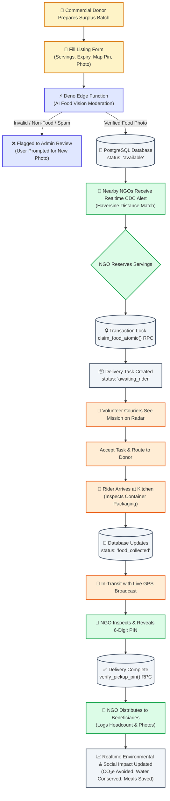

---

## 🏊 2. Four-Party Stakeholder Swimlane Workflow

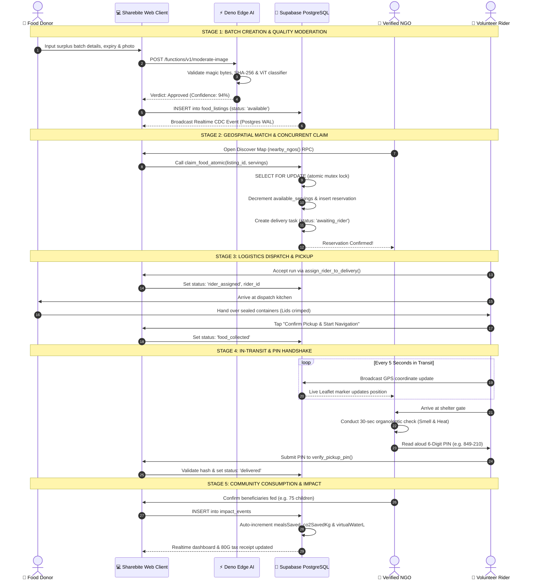

---

## 🔍 3. Sequence Diagram: Food Listing & Edge AI Vision Moderation

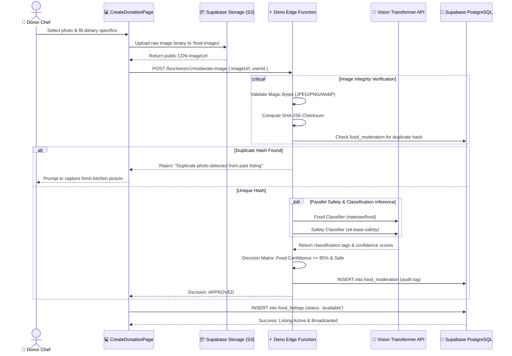

---

## 🔒 4. Sequence Diagram: NGO Claiming & Concurrency Row-Locking

How Sharebite prevents **race conditions** and double-allocation when multiple NGOs simultaneously claim the same surplus batch during peak evening hours:

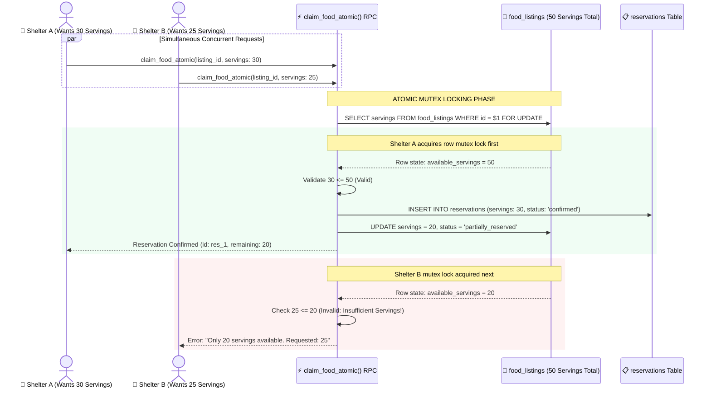

---

## 🛵 5. Sequence Diagram: Logistics Dispatch & 6-Digit PIN Handshake

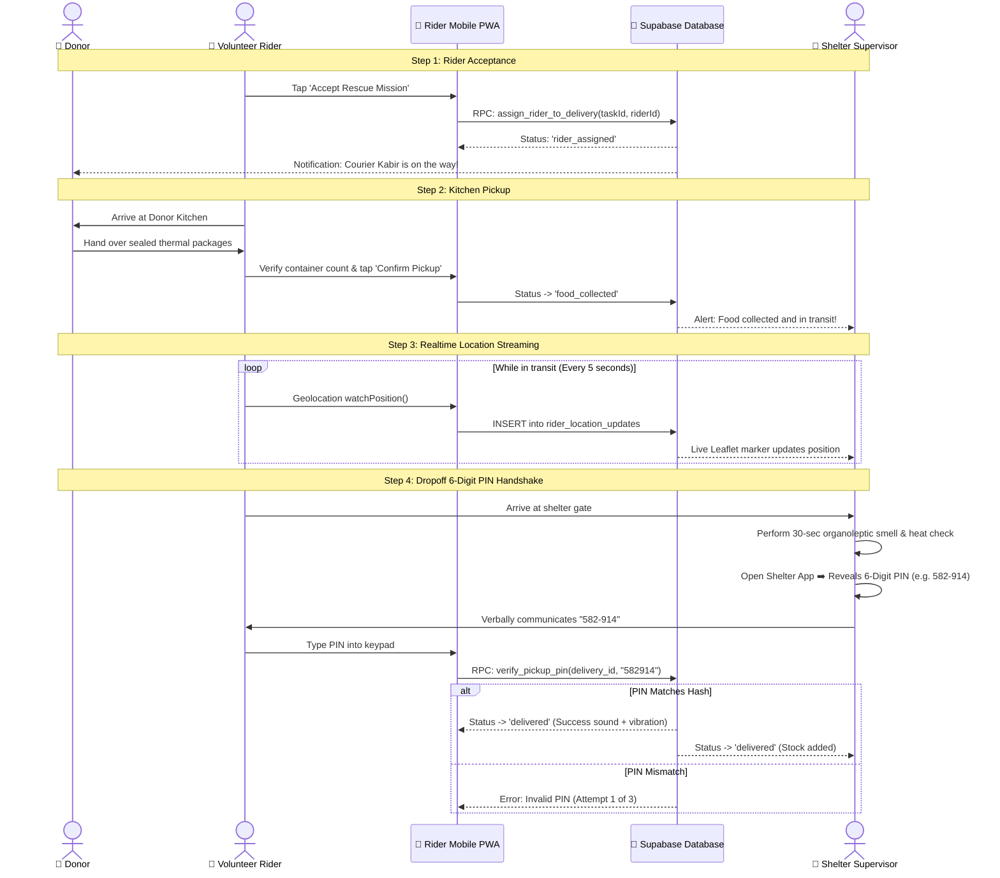

---

## 🍲 6. Sequence Diagram: Community Distribution & Impact Calculation

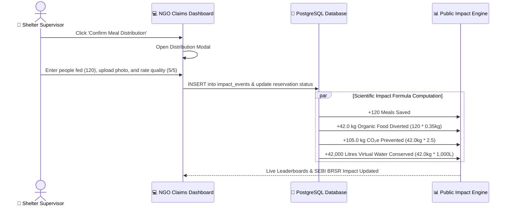

---

## 🏷️ 7. Food Listing Lifecycle State Machine

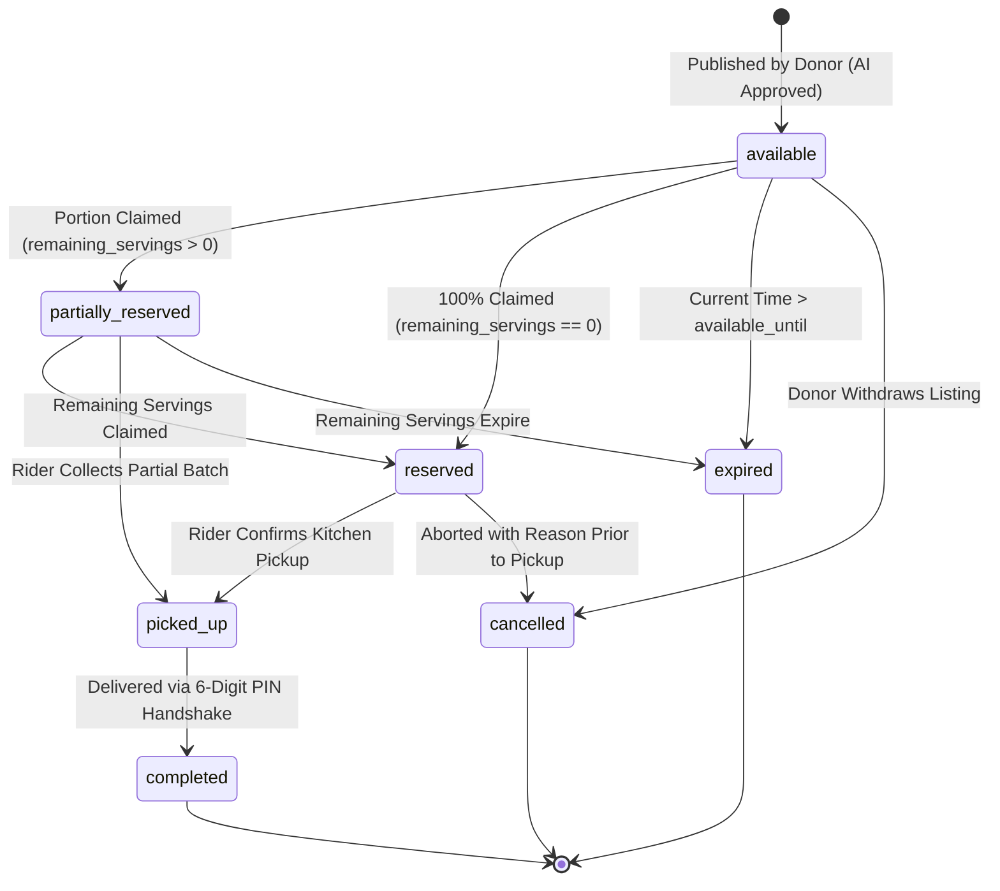

---

## 📦 8. NGO Reservation & Delivery Lifecycle State Machine

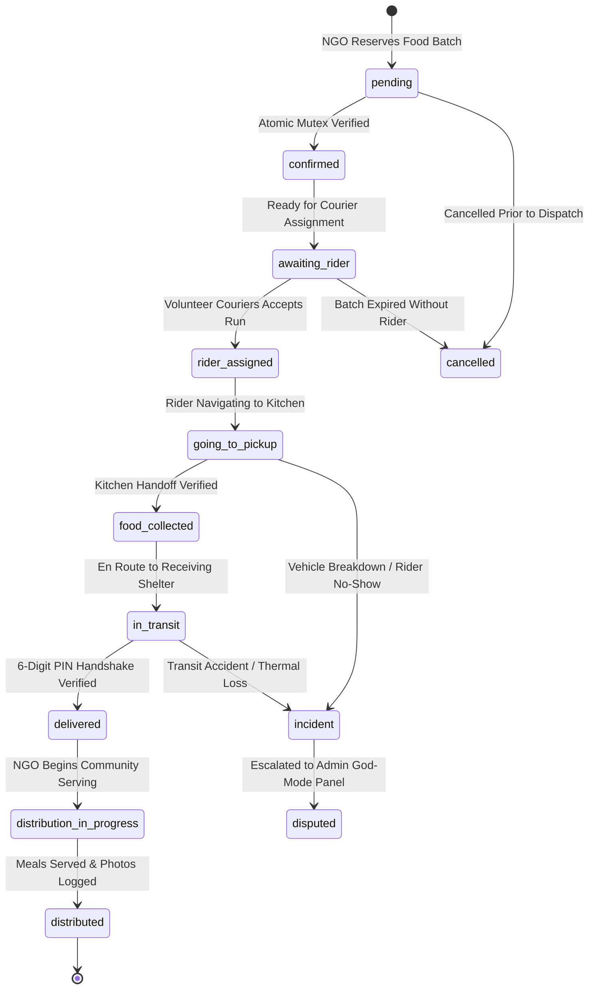

---

## 📱 9. Offline-First Rider Cache & Sync Workflow

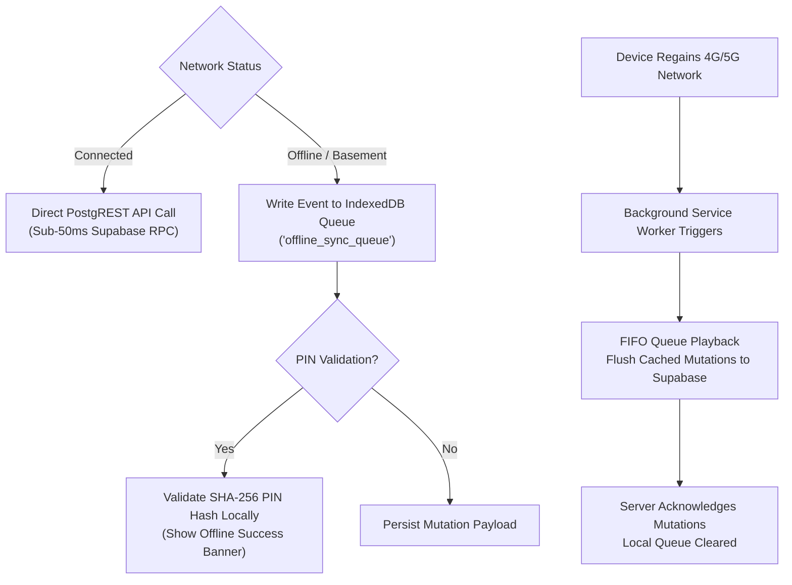

---

## 🌡️ 10. FSSAI Organoleptic Food Inspection Flow

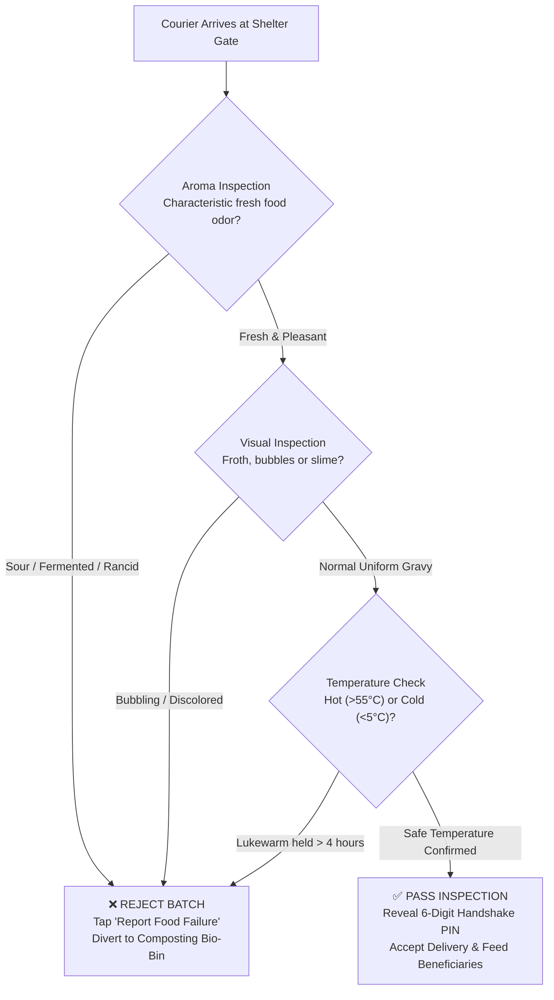

---

## 🚨 11. Exception Handling & Incident Escalation (SOP-911)

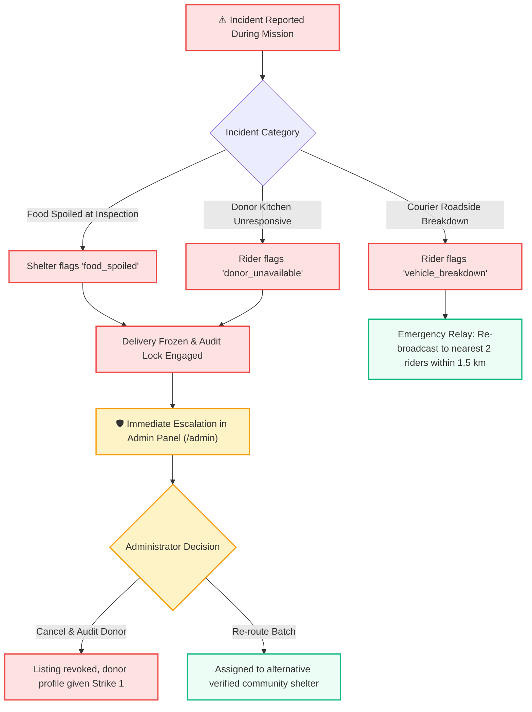

---

*Sharebite Visual Flow Specifications v2.4 • Maintained by Sharebite Engineering Core Team*